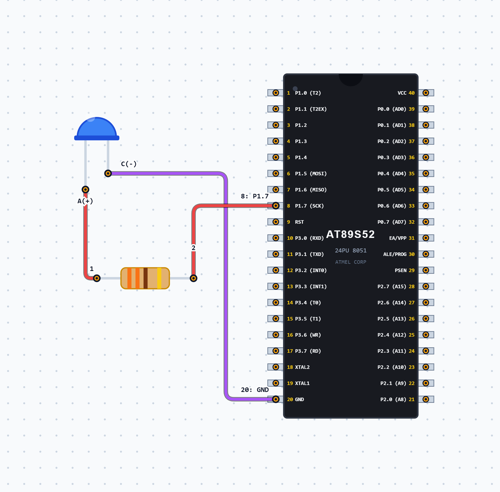
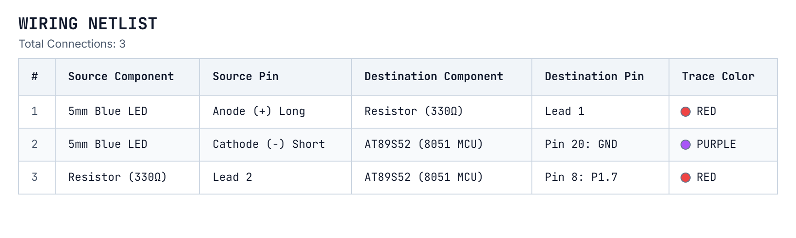

[← Back to 8051 Index](../../README.md) | [← Back to Root Repository](../../../README.md)

# CAT-2 TASK-2B

| Field | Details |
| :--- | :--- |
| **EXP** | Continuous Lab Evaluation-2 (`CAT2` / `TASK2B`) |
| **TASK NO** | **Task 2B — Bare-Metal LED Blink & Custom Delay Library** |
| **DATE** | 24/07/2026 |
| **NAME OF EXP** | Bare-Metal LED Blink |

## HARDWARE SETUP / PLATFORM
- **Development Board:** 8051 Development Board
- **Microcontroller IC & Model:** Atmel `AT89S52` (8-bit 8051 Architecture)
- **Toolchain / IDE:** Keil µVision (`blinker.uvproj`)
- **Firmware Approach:** Bare-metal Embedded C with direct SFR bit-addressable access (`<reg51.h>`)
- **Peripherals:** User LED with 330Ω current-limiting resistor
- **Pin Mapping:**
  - `P1.7` — User LED output (active-low)

## Circuit Diagram

### Hardware Schematic

### Wiring Interconnects Table

## Core Logic / Pseudocode / Code Base

### Working Principle
- `P1.7` is mapped directly to the bit-addressable variable `led` using `sbit led = P1^7;` from `<reg51.h>`.
- Because the LED is wired in an active-low configuration (anode to `+5V` via resistor, cathode to `P1.7`), clearing `led = 0` sinks current to turn the LED **ON**, and setting `led = 1` turns it **OFF**.
- A modular software delay library (`delay.h` / `delay.c`) executes nested `for` loops (`delay_loop(35, 350)`) via `delay_1Hz()` between state transitions to blink the LED at approximately `1 Hz`.

### Pseudocode
- Include `<reg51.h>` and `"delay.h"`, and map `sbit led = P1^7`.
- Enter infinite `while(1)` loop:
  - Drive `led = 0` (turn LED ON).
  - Call `delay_1Hz()` (`delay_loop(35, 350)`).
  - Drive `led = 1` (turn LED OFF).
  - Call `delay_1Hz()` (`delay_loop(35, 350)`).

### Code Base
Project files in `8051/CAT2/TASK2B/`:
- `blinker.uvproj` & `STARTUP.A51` – Keil µVision project file and 8051 startup assembly file.
- `main.c` – Maps `P1.7` (`sbit led`) and toggles the LED state in an infinite loop.
- `delay.h` – Declares the `delay_1Hz()` function prototype.
- `delay.c` – Implements `delay_loop(int a, int b)` and `delay_1Hz()` using nested software delay loops.

## INFERENCE
- Verified the Keil µVision build and AT89S52 target flashing workflow using bare-metal Embedded C without abstraction frameworks.
- Implemented direct bit-addressable GPIO control (`sbit` on `P1.7`) and separated blocking software timing into a reusable `delay.h`/`delay.c` library module.
