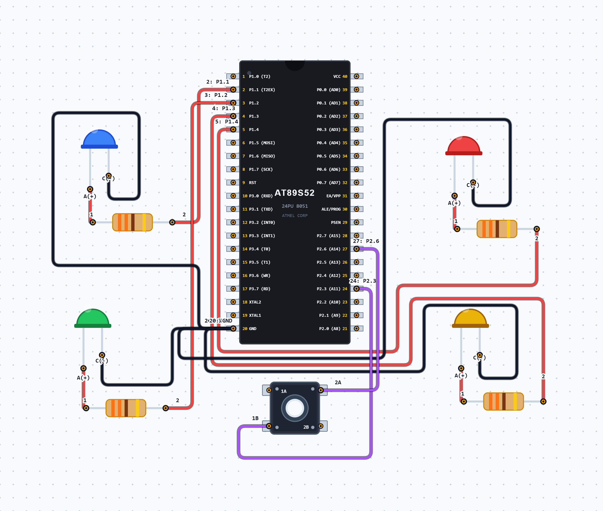
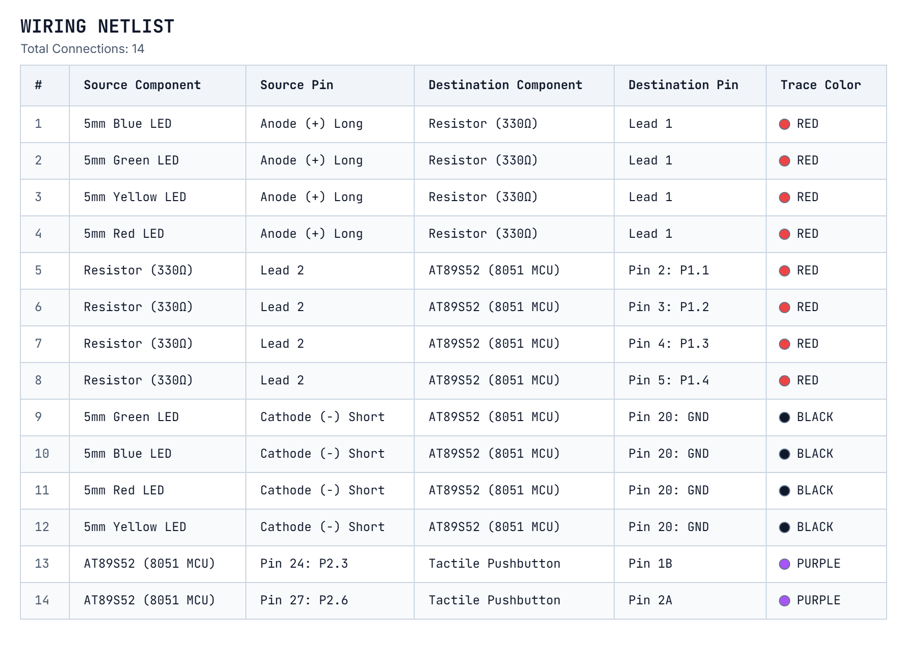

[← Back to 8051 Index](../../README.md) | [← Back to Root Repository](../../../README.md)

# CAT-3 TASK-3A

| Field | Details |
| :--- | :--- |
| **EXP** | Continuous Lab Evaluation-3 (`CAT3` / `TASK3A`) |
| **TASK NO** | **Task 3A — Multi-Mode LED Pattern Generator & Switch Control** |
| **DATE** | 31/07/2026 |
| **NAME OF EXP** | Timer-Based LED Pattern Generator and Button Interrupt Controller |

## HARDWARE SETUP / PLATFORM
- **Development Board:** 8051 Development Board
- **Microcontroller IC & Model:** Atmel `AT89S52` (8-bit 8051 Architecture)
- **Toolchain / IDE:** Keil µVision (`led_button.uvproj`)
- **Firmware Approach:** Bare-metal Embedded C with direct SFR bit-addressable access (`<reg51.h>`)
- **Peripherals:** 4 User LEDs (with 330Ω current-limiting resistors) and 1 Tactile Push-Button Switch
- **Pin Mapping:**
  - `P1.1` — `led1` digital output (active-high)
  - `P1.2` — `led2` digital output (active-high)
  - `P1.3` — `led3` digital output (active-high)
  - `P1.4` — `led4` digital output (active-high)
  - `P2.3` — `button` digital input (active-low)
  - `P2.6` — `s_out` digital output driven LOW (`0`) as switch reference

## Circuit Diagram

### Hardware Schematic

### Wiring Interconnects Table

## Core Logic / Pseudocode / Code Base

### Working Principle
- `pins.h` maps four active-high LEDs (`P1.1`–`P1.4`), an active-low push-button input (`P2.3`), and a LOW-driven switch reference pin (`P2.6 = 0`) via `sbit` definitions.
- `main.c` implements a state machine (`mode` `0` to `4`) that waits in idle (`mode 0`) until the initial button press, then cycles sequentially through four distinct LED patterns on each subsequent button press:
  - **Mode 1 (`mode1`):** Sequential running LED (`LED1` → `LED2` → `LED3` → `LED4`).
  - **Mode 2 (`mode2`):** 4-bit binary up-counter (`0000` to `1111`) across `LED1`–`LED4`.
  - **Mode 3 (`mode3`):** Alternating odd/even LED pairs (`LED1`/`LED3` vs. `LED2`/`LED4`).
  - **Mode 4 (`mode4`):** Simultaneous flashing of all four LEDs (`ON` / `OFF`).
- Between pattern steps, `chkbutton()` polls `P2.3 == 0`, waits for button release (`while(button == 0)`), and returns `1` so the active pattern exits immediately into the next mode.

### Pseudocode
- Initialize `led1`–`led4` to `0` (OFF), `s_out = 0`, and `mode = 0`.
- Continuously evaluate `switch(mode)` inside `while(1)`:
  - `case 0` (Idle): Poll `chkbutton()`; if pressed, transition to `mode = 1`.
  - `case 1`: Execute `mode1()` (Running LED) until `chkbutton()` returns `1`, then advance to `mode = 2`.
  - `case 2`: Execute `mode2()` (4-bit Binary Counter) until `chkbutton()` returns `1`, then advance to `mode = 3`.
  - `case 3`: Execute `mode3()` (Alternating Pairs) until `chkbutton()` returns `1`, then advance to `mode = 4`.
  - `case 4`: Execute `mode4()` (All LEDs Flash) until `chkbutton()` returns `1`, then wrap back to `mode = 1`.

### Code Base
Project files in `8051/CAT3/TASK3A/`:
- `led_button.uvproj` & `STARTUP.A51` – Keil µVision project configuration and 8051 startup code.
- `pins.h` – Declares `sbit` mappings for `led1`–`led4` (`P1.1`–`P1.4`), `button` (`P2.3`), and `s_out` (`P2.6`).
- `main.c` – Initializes port states and runs the `switch(mode)` state machine.
- `modes.h` & `modes.c` – Implements `chkbutton()` edge/release polling and the four LED pattern routines (`mode1`–`mode4`).
- `delay.h` & `delay.c` – Provides `delay_1Hz()` software timing between LED transitions.

## INFERENCE
- Implemented a modular, state-machine-driven 4-LED pattern controller on the AT89S52 using bare-metal `sbit` register manipulation.
- Verified clean mode switching across Running LED, 4-bit Binary Counter, Alternating Pair, and All-Flash patterns using active-low push-button polling with release synchronization (`chkbutton()`).
