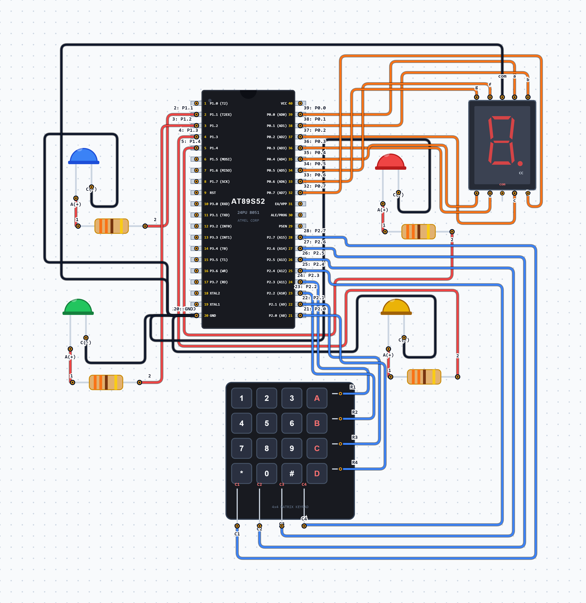
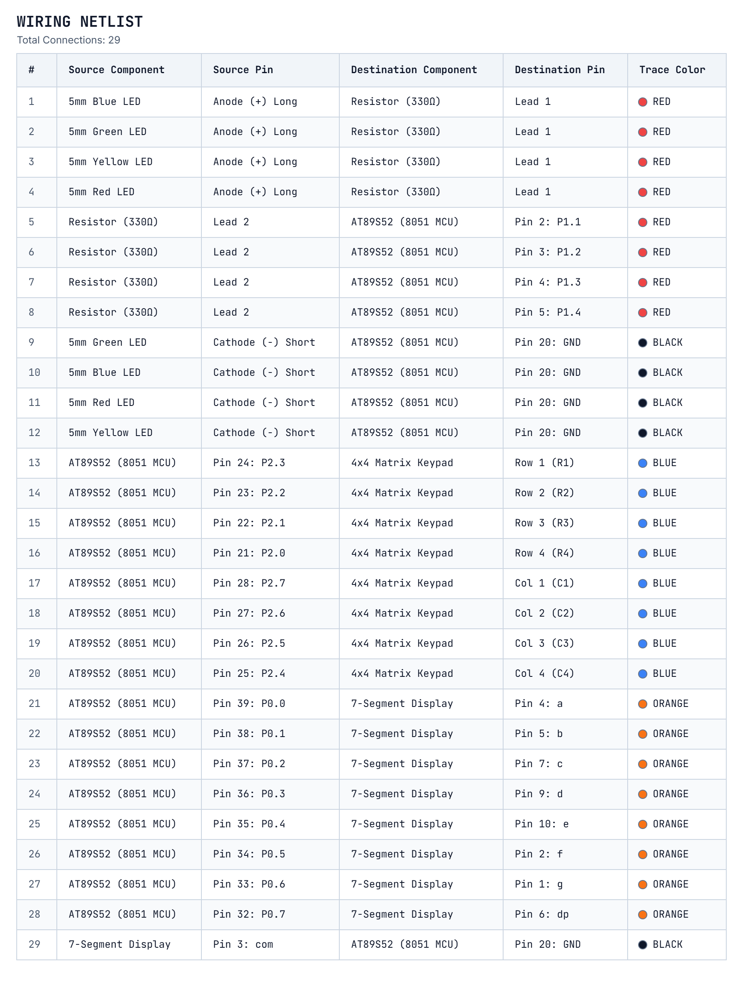

[← Back to 8051 Index](../../README.md) | [← Back to Root Repository](../../../README.md)

# CAT-4 TASK-4A

| Field | Details |
| :--- | :--- |
| **EXP** | Continuous Lab Evaluation-4 (`CAT4` / `TASK4A`) |
| **TASK NO** | **Task 4A — Matrix Keypad, LEDs & Seven-Segment HMI** |
| **DATE** | 07/08/2026 |
| **NAME OF EXP** | Human-Machine Interface using Matrix Keypad, LEDs, and Seven-Segment Display |

## HARDWARE SETUP / PLATFORM
- **Development Board:** 8051 Development Board
- **Microcontroller IC & Model:** Atmel `AT89S52` (8-bit 8051 Architecture)
- **Toolchain / IDE:** Keil µVision (`led_keypad_display.uvproj`)
- **Firmware Approach:** Bare-metal Embedded C with direct SFR port and bit access (`<reg51.h>`)
- **Peripherals:** 4×4 Matrix Keypad, 4 User LEDs (with 330Ω resistors), and Common-Cathode Seven-Segment Display
- **Pin Mapping:**
  - `P2.3`–`P2.0` — Matrix keypad rows `R1`–`R4`
  - `P2.7`–`P2.4` — Matrix keypad columns `C1`–`C4`
  - `P1.1`–`P1.4` — User LEDs `led1`–`led4` (active-high)
  - `P0.0`–`P0.7` — Common-cathode seven-segment display (`seg`)

## Circuit Diagram

### Hardware Schematic

### Wiring Interconnects Table

## Core Logic / Pseudocode / Code Base

### Working Principle
- `keypad_scan()` drives one keypad row (`R1`–`R4` on `P2.3`–`P2.0`) LOW at a time while keeping the remaining three HIGH, sensing columns (`C1`–`C4` on `P2.7`–`P2.4`) with a `20 ms` debounce and release wait to decode the pressed key (`0`–`15`).
- `display_digit()` writes the common-cathode segment lookup byte (`seg_code[0..9]`) to `Port 0` (`seg`) whenever `key <= 9`.
- `led_control()` maps numeric key inputs to individual LED states or multi-step animated LED patterns on `P1.1`–`P1.4`:
  - `1`–`4` — Turns ON `led1`–`led4` individually.
  - `5` — Runs sequential LED chase (`running_led()`).
  - `6` — Toggles alternating LED pairs (`alternate_led()`).
  - `7` — Executes 4-bit binary up-counter `0`–`15` (`binary_counter()`).
  - `8` — Blinks all four LEDs simultaneously (`blink_all()`).
  - `0` — Turns all LEDs OFF.
- During pattern animations, `pattern_delay()` polls `keypad_scan()` in `20 ms` increments so pressing a new key immediately interrupts the active pattern.

### Pseudocode
- Include `<reg51.h>`, `"pins.h"`, `"delay.h"`, and `"functions.h"`.
- Continuously execute inside `while(1)`:
  - Call `keypad_scan()` to scan rows `R1`–`R4` and columns `C1`–`C4`, debouncing (`delay(20)`) and updating global `key`.
  - Call `display_digit(key)` to output `seg_code[key]` onto `Port 0` if `key <= 9`.
  - Call `led_control(key)` to drive individual LEDs (`1`–`4`), execute animated patterns (`5`–`8`), or clear all LEDs (`0`).

### Code Base
Project files in `8051/CAT4/TASK4A/`:
- `led_keypad_display.uvproj` & `STARTUP.A51` – Keil µVision project configuration and 8051 startup code.
- `pins.h` – Defines `sbit` mappings for keypad rows (`P2.3`–`P2.0`), columns (`P2.7`–`P2.4`), LEDs (`P1.1`–`P1.4`), and `seg` (`P0`).
- `main.c` – Runs the main HMI loop calling `keypad_scan()`, `display_digit()`, and `led_control()`.
- `functions.h` & `functions.c` – Implements `keypad_scan()`, `display_digit()`, `led_control()`, `pattern_delay()`, and pattern routines (`running_led`, `alternate_led`, `binary_counter`, `blink_all`).
- `delay.h` & `delay.c` – Implements nested software delay loops (`delay_loop`, `delay`, `delay_1Hz`).

## INFERENCE
- Integrated a 4×4 matrix keypad, four LEDs, and a common-cathode seven-segment display on the AT89S52 using bare-metal port manipulation across `Port 0`, `Port 1`, and `Port 2`.
- Verified responsive human-machine interaction where keypad presses update the seven-segment readout (`0`–`9`) and switch between static LED indicators and interruptible LED patterns (`pattern_delay()`).
