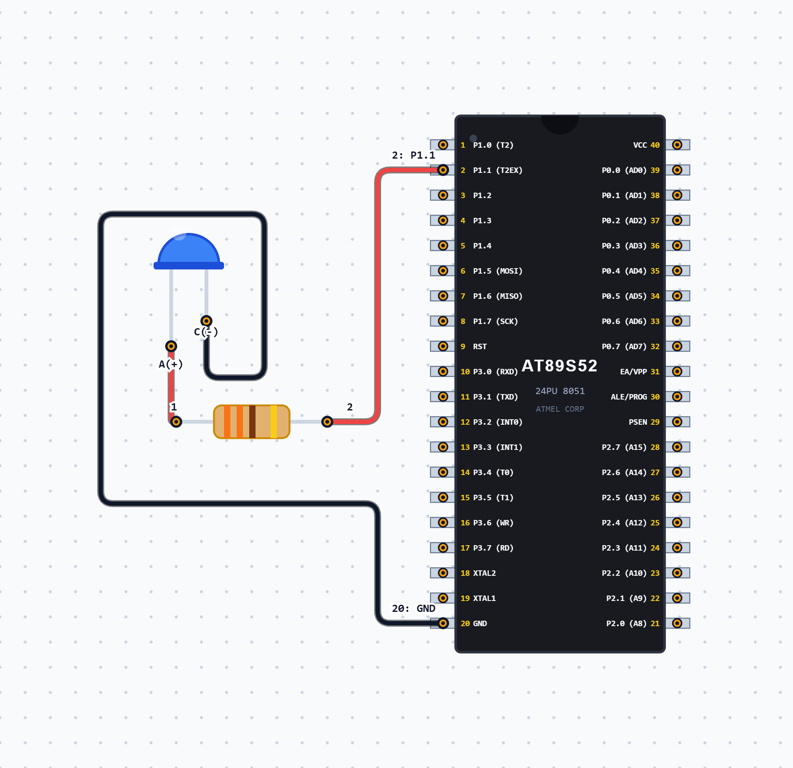
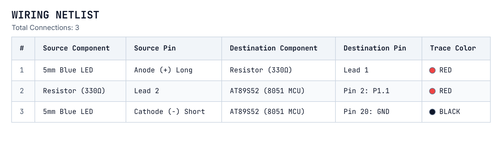

[← Back to 8051 Index](../../README.md) | [← Back to Root Repository](../../../README.md)

# CAT-5 TASK-5A

| Field | Details |
| :--- | :--- |
| **EXP** | Continuous Lab Evaluation-5 (`CAT5` / `TASK5A`) |
| **TASK NO** | **Task 5A — Hardware Timer-Based LED Blinking (`Timer 0` Polling)** |
| **DATE** | 14/08/2026 |
| **NAME OF EXP** | Hardware Timer and Interrupt-Based Timing for LED Fading, Pulse Generation, and Stepper Motor Control |

## HARDWARE SETUP / PLATFORM
- **Development Board:** 8051 Development Board
- **Microcontroller IC & Model:** Atmel `AT89S52` (8-bit 8051 Architecture)
- **Toolchain / IDE:** Keil µVision (`led_timer.uvproj`)
- **Firmware Approach:** Bare-metal Embedded C with direct SFR timer register access (`<reg51.h>`)
- **Peripherals:** User LED with 330Ω current-limiting resistor
- **Pin Mapping:**
  - `P1.1` — User LED digital output (`led`)

## Circuit Diagram

### Hardware Schematic

### Wiring Interconnects Table

## Core Logic / Pseudocode / Code Base

### Working Principle
- `Timer 0` is configured in **Mode 1 (16-bit non-auto-reload timer)** by setting `TMOD = 0x01`, preloading `TH0 = 0xFA` and `TL0 = 0x9A` (`64154` decimal = `1382` machine cycles per overflow, ~`1.5 ms` at `11.0592 MHz`), and starting the timer (`TR0 = 1`).
- Instead of blocking software loops, the firmware polls the `Timer 0` overflow flag (`TF0 == 1`).
- On each overflow, `TF0` is cleared in software, `TH0`/`TL0` are reloaded with `0xFA9A`, and `count` increments. Once `count >= 533` (~`800 ms` half-period), `led` (`P1.1`) is inverted (`led = ~led`) and `count` resets to `0`.

### Pseudocode
- Initialize `led = 0` (`P1.1` LOW) in `main()` and invoke `timer0_init()`.
- Configure `TMOD = 0x01` (Timer 0, 16-bit Mode 1), load `TH0 = 0xFA` and `TL0 = 0x9A`, and start Timer 0 (`TR0 = 1`).
- Loop continuously:
  - Wait until Timer 0 overflow flag `TF0 == 1`.
  - Clear `TF0 = 0`, increment `count`, and reload `TH0 = 0xFA`, `TL0 = 0x9A`.
  - When `count >= 533`, toggle `led = ~led` and reset `count = 0`.

### Code Base
Project files in `8051/CAT5/TASK5A/`:
- `led_timer.uvproj` & `STARTUP.A51` – Keil µVision project file and 8051 startup code.
- `pins.h` – Maps `sbit led = P1^1;` using `<reg51.h>`.
- `main.c` – Initializes `led = 0` and calls `timer0_init()`.
- `functions.h` & `functions.c` – Configures `TMOD`, `TH0`, `TL0`, `TR0`, and polls `TF0` to toggle `P1.1` every 533 overflows.

## INFERENCE
- Replaced imprecise blocking software delay loops with deterministic hardware timing using `Timer 0` in 16-bit Mode 1 (`TMOD = 0x01`) on the AT89S52.
- Verified `TF0` overflow flag polling and manual 16-bit register reloading (`TH0 = 0xFA`, `TL0 = 0x9A`) to generate consistent periodic LED toggling on `P1.1`.
