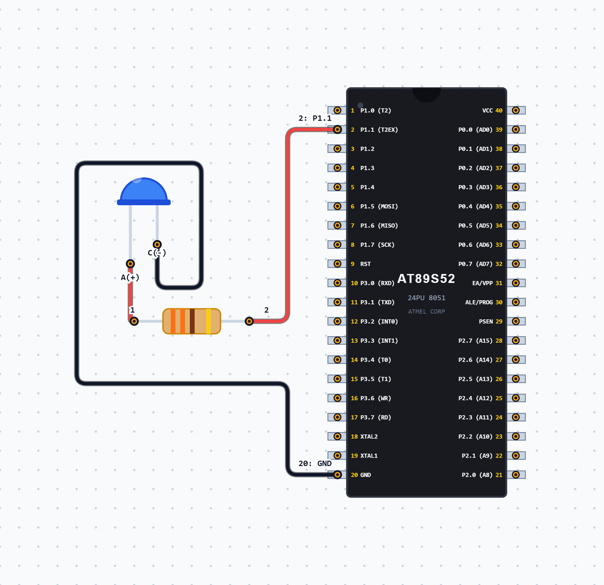
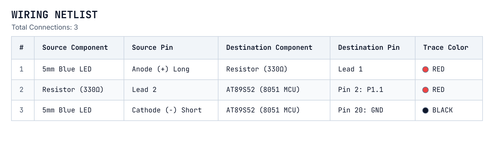

[← Back to 8051 Index](../../../README.md) | [← Back to Root Repository](../../../../README.md)

# CAT-5 TASK-5B.1

| Field | Details |
| :--- | :--- |
| **EXP** | Continuous Lab Evaluation-5 (`CAT5` / `TASK5B.1`) |
| **TASK NO** | **Task 5B.1 — Timer-Based Software PWM LED Fading** |
| **DATE** | 14/08/2026 |
| **NAME OF EXP** | Hardware Timer and Interrupt-Based Timing for LED Fading, Pulse Generation, and Stepper Motor Control |

## HARDWARE SETUP / PLATFORM
- **Development Board:** 8051 Development Board
- **Microcontroller IC & Model:** Atmel `AT89S52` (8-bit 8051 Architecture)
- **Toolchain / IDE:** Keil µVision
- **Firmware Approach:** Bare-metal Embedded C with direct SFR timer register access (`<reg52.h>`)
- **Peripherals:** User LED with 330Ω current-limiting resistor
- **Pin Mapping:**
  - `P1.0` — Software PWM LED output (`LED`, active-high)

## Circuit Diagram

### Hardware Schematic

### Wiring Interconnects Table

## Core Logic / Pseudocode / Code Base

### Working Principle
- `Timer 0` is configured in **16-bit Mode 1** (`TMOD = 0x01`) with reload value `0xFEA3` (`65187` decimal = `349` machine cycles per tick), generating a high-frequency software PWM timebase.
- A 20-step PWM period (`pwm_tick` from `0` to `19`) compares `pwm_tick < duty_cycle` on every timer overflow:
  - `pwm_tick < duty_cycle` → Drives `P1.0` (`LED = 1`, ON).
  - `pwm_tick >= duty_cycle` → Clears `P1.0` (`LED = 0`, OFF).
- Every `200` timer ticks (`fade_delay >= 200`), `duty_cycle` increments from `0` to `20` while `brightening == 1` and decrements back to `0` while `brightening == 0`, creating a smooth breathing/fading brightness effect.

### Pseudocode
- Configure `TMOD = 0x01` (Timer 0, 16-bit Mode 1), preload `TH0 = 0xFE`, `TL0 = 0xA3`, and start Timer 0 (`TR0 = 1`).
- Initialize `pwm_tick = 0`, `duty_cycle = 0`, `brightening = 1`, and `fade_delay = 0`.
- Continuously loop in `while(1)`:
  - Wait for Timer 0 overflow flag `TF0 == 1`.
  - Clear `TF0 = 0`, reload `TH0 = 0xFE`, `TL0 = 0xA3`, and increment `pwm_tick` (wrapping modulo `20`).
  - Drive `LED = 1` if `pwm_tick < duty_cycle`, else `LED = 0`.
  - Increment `fade_delay`; when `fade_delay >= 200`, reset `fade_delay = 0` and step `duty_cycle` up (`0 → 20`) or down (`20 → 0`) according to `brightening`.

### Code Base
Project files in `8051/CAT5/TASK5B/TASK5B.1/`:
- `main.c` – Implements `Timer 0` Mode 1 initialization (`0xFEA3`), 20-step software PWM generation on `P1.0`, and triangular duty-cycle modulation for smooth LED fading.

## INFERENCE
- Implemented software Pulse Width Modulation (PWM) on the AT89S52 using `Timer 0` in 16-bit Mode 1 despite the lack of dedicated hardware PWM peripherals.
- Verified smooth, flicker-free LED brightness ramping (fade-in and fade-out) on `P1.0` by modulating `duty_cycle` between `0%` (`0/20`) and `100%` (`20/20`).
