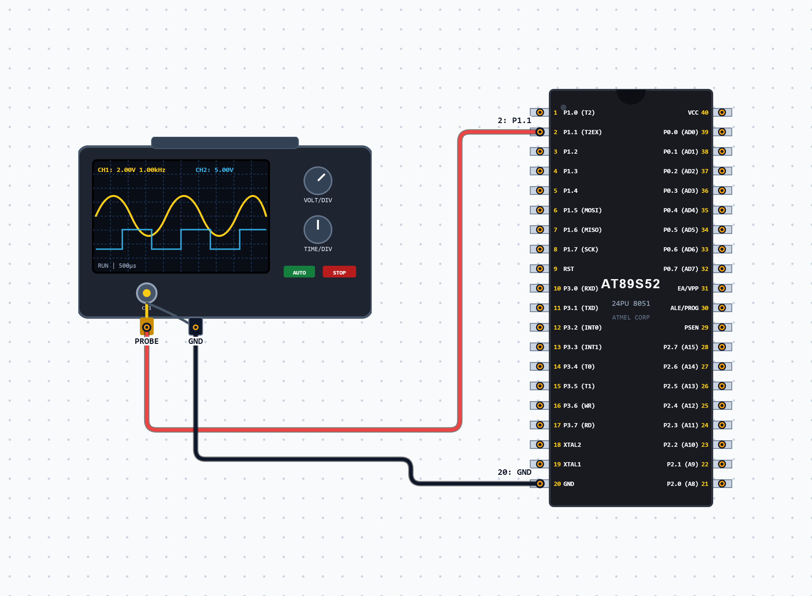
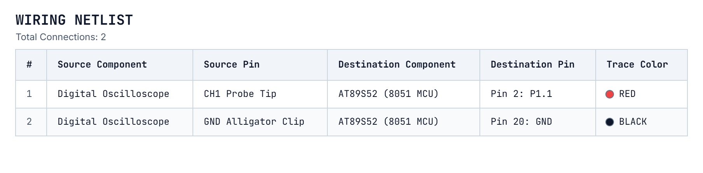

[← Back to 8051 Index](../../../README.md) | [← Back to Root Repository](../../../../README.md)

# CAT-5 TASK-5B.2

| Field | Details |
| :--- | :--- |
| **EXP** | Continuous Lab Evaluation-5 (`CAT5` / `TASK5B.2`) |
| **TASK NO** | **Task 5B.2 — Timer-Driven Multi-Frequency Square Wave Generator** |
| **DATE** | 14/08/2026 |
| **NAME OF EXP** | Hardware Timer and Interrupt-Based Timing for LED Fading, Pulse Generation, and Stepper Motor Control |

## HARDWARE SETUP / PLATFORM
- **Development Board:** 8051 Development Board
- **Microcontroller IC & Model:** Atmel `AT89S52` (8-bit 8051 Architecture, 11.0592 MHz Crystal)
- **Toolchain / IDE:** Keil µVision
- **Firmware Approach:** Bare-metal Embedded C with direct SFR timer register access (`<reg52.h>`)
- **Peripherals / Instruments:** Digital Oscilloscope / Logic Analyzer
- **Pin Mapping:**
  - `P1.1` — Square-wave pulse output (`WAVE_OUT`)

## Circuit Diagram

### Hardware Schematic

### Wiring Interconnects Table

## Core Logic / Pseudocode / Code Base

### Working Principle
- `Timer 0` is configured in **16-bit Mode 1** (`TMOD = 0x01`) to generate precision half-period delays for toggling `P1.1` (`WAVE_OUT`), creating a `50%` duty-cycle square wave.
- A `switch(wave_mode)` selector loads pre-calculated `TH0` and `TL0` reload constants corresponding to five target output frequencies (`wave_mode = 3` selects `1 kHz`):
  - `wave_mode = 1` (`100 Hz`, `5000 µs` half-period) → `0xEE00`
  - `wave_mode = 2` (`500 Hz`, `1000 µs` half-period) → `0xFC66`
  - `wave_mode = 3` (`1 kHz`, `500 µs` half-period) → `0xFE33`
  - `wave_mode = 4` (`2 kHz`, `250 µs` half-period) → `0xFF1A`
  - `wave_mode = 5` (`5 kHz`, `100 µs` half-period) → `0xFEA4`
- Each time `TF0` sets, the firmware stops `Timer 0` (`TR0 = 0`), reloads `TH0`/`TL0`, restarts `Timer 0` (`TR0 = 1`), and inverts `WAVE_OUT = ~WAVE_OUT`.

### Pseudocode
- Select `wave_mode` (`3` = `1 kHz`) and assign `reload_high` (`0xFE`) and `reload_low` (`0x33`) via `switch(wave_mode)`.
- Set `TMOD = 0x01` (Timer 0, 16-bit Mode 1), load `TH0` and `TL0`, and start Timer 0 (`TR0 = 1`).
- Continuously loop in `while(1)`:
  - Poll Timer 0 overflow flag `TF0 == 1`.
  - Clear `TF0 = 0`, stop `TR0 = 0`, reload `TH0 = reload_high` and `TL0 = reload_low`, and restart `TR0 = 1`.
  - Invert `WAVE_OUT = ~WAVE_OUT` (`P1.1`).

### Code Base
Project files in `8051/CAT5/TASK5B/TASK5B.2/`:
- `main.c` – Configures `Timer 0` Mode 1 reload registers (`0xEE00`–`0xFF1A`) for selectable output frequencies (`100 Hz` to `5 kHz`) and toggles `P1.1` on each overflow.

## INFERENCE
- Demonstrated hardware-timed square-wave synthesis (`100 Hz` to `5 kHz`) on `P1.1` of the AT89S52 using `Timer 0` in 16-bit Mode 1 (`TMOD = 0x01`).
- Verified accurate `50%` duty-cycle pulse generation by computing 16-bit `TH0`/`TL0` reload values from machine-cycle half-periods (`11.0592 MHz` crystal).
