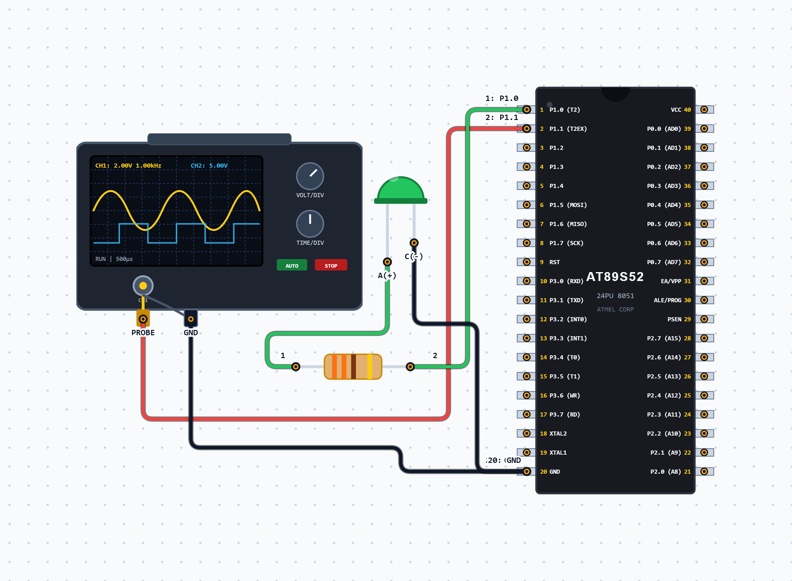
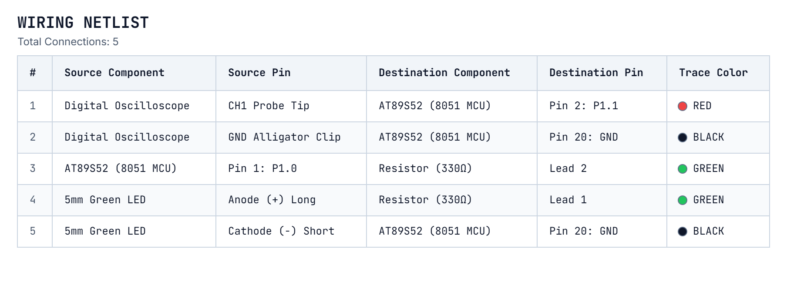

[← Back to 8051 Index](../../../README.md) | [← Back to Root Repository](../../../../README.md)

# CAT-5 TASK-5B.3

| Field | Details |
| :--- | :--- |
| **EXP** | Continuous Lab Evaluation-5 (`CAT5` / `TASK5B.3`) |
| **TASK NO** | **Task 5B.3 — Timer 1 Interrupt-Driven Waveform & PWM Generation** |
| **DATE** | 14/08/2026 |
| **NAME OF EXP** | Hardware Timer and Interrupt-Based Timing for LED Fading, Pulse Generation, and Stepper Motor Control |

## HARDWARE SETUP / PLATFORM
- **Development Board:** 8051 Development Board
- **Microcontroller IC & Model:** Atmel `AT89S52` (8-bit 8051 Architecture)
- **Toolchain / IDE:** Keil µVision
- **Firmware Approach:** Bare-metal Embedded C using Hardware Timer Interrupts (`Timer 1`, `interrupt 3`, `<reg51.h>`)
- **Peripherals / Instruments:** User LED (with 330Ω resistor) and Digital Oscilloscope / Logic Analyzer
- **Pin Mapping:**
  - `P1.1` — Burst signal and pulse-train waveform output (`out`)
  - `P1.0` — Variable duty-cycle PWM output (`led`)

## Circuit Diagram

### Hardware Schematic

### Wiring Interconnects Table

## Core Logic / Pseudocode / Code Base

### Working Principle
- `Timer 1` is configured in **16-bit Mode 1** (`TMOD = 0x10`) with global and Timer 1 interrupts enabled (`EA = 1`, `ET1 = 1`), executing all waveform logic inside `void timer1(void) interrupt 3` while `main()` remains idle in `while(1)`.
- Three interrupt-driven waveform modes are implemented across the source files:
  1. **Burst Signal Mode (`out` on `P1.1`, reload `0xFC66`):** Cycles a 30-tick frame (`i = 0..29`), toggling `P1.1` for ticks `0..9`, holding `P1.1 = 0` during ticks `10..19` (silent gap), and toggling `P1.1` again for ticks `20..29`.
  2. **Pulse Train Mode (`out` on `P1.1`, reload `0xFC66`):** Cycles an 8-tick period (`i = 0..7`), driving `P1.1 = 1` on tick `0` and `P1.1 = 0` on ticks `1..7` to generate a `12.5%` duty-cycle periodic pulse train.
  3. **Variable Duty Cycle PWM (`led` on `P1.0`, reload `0xFFF7`):** Compares `count < duty` across a 100-step PWM frame (`count = 0..99`) and ramps `duty` between `0%` and `100%` every 10 frames (`fcount >= 10`) for smooth interrupt-driven LED brightness fading.

### Pseudocode
- Initialize output pin (`P1.1` or `P1.0`) to `0`.
- Configure `TMOD = 0x10` (Timer 1, 16-bit Mode 1), load initial `TH1`/`TL1` values, enable `ET1 = 1` and `EA = 1`, and start Timer 1 (`TR1 = 1`).
- Keep `main()` idle in `while(1)` while `timer1(void) interrupt 3` handles waveform generation:
  - Reload `TH1` and `TL1` (`0xFC66` for burst/pulse train; `0xFFF7` for 100-step PWM).
  - **Burst Mode:** Toggle `out` for `i < 10` and `i >= 20`, hold `out = 0` for `10 <= i < 20`, wrap `i` at `30`.
  - **Pulse Train Mode:** Set `out = 1` when `i == 0`, else `out = 0`, wrap `i` at `8`.
  - **Variable Duty Cycle Mode:** Drive `led = (count < duty)`, wrap `count` at `100`, and sweep `duty` (`0 ↔ 100`) every 10 frames.

### Code Base
Project files in `8051/CAT5/TASK5B/TASK5B.3/`:
- `burst.c` – Generates gated burst-signal packets on `P1.1` inside `timer1() interrupt 3`.
- `pulse_train.c` – Generates a 1-in-8 (`12.5%` duty-cycle) periodic pulse train on `P1.1` inside `timer1() interrupt 3`.
- `variable_duty.c` – Generates 100-level interrupt-driven PWM ramping (`0%` to `100%`) on `P1.0` inside `timer1() interrupt 3`.

## INFERENCE
- Transitioned from CPU-blocking flag polling to non-blocking, interrupt-driven timing (`Timer 1`, `interrupt 3`) on the AT89S52, freeing the main loop (`while(1)`).
- Verified deterministic generation of gated burst waveforms, fixed-duty pulse trains (`12.5%`), and 100-step variable duty-cycle PWM signals via hardware timer interrupts.
