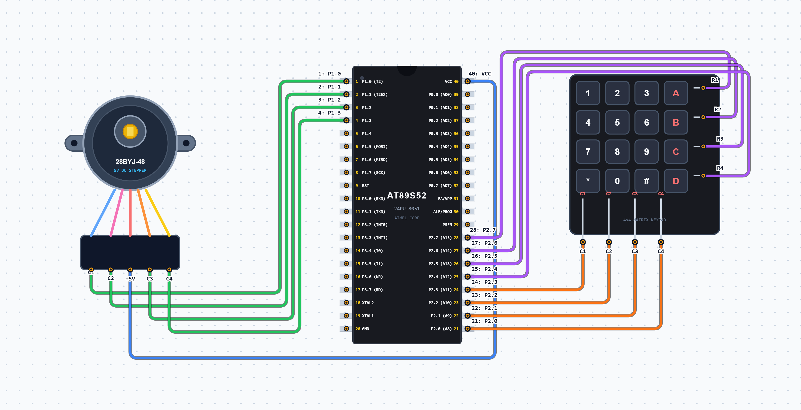
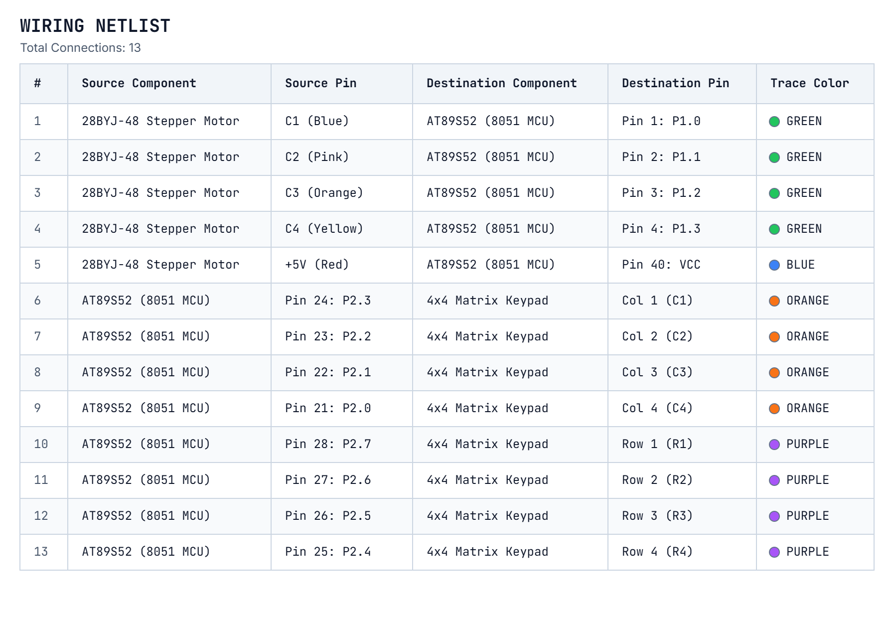

[← Back to 8051 Index](../../README.md) | [← Back to Root Repository](../../../README.md)

# CAT-5 TASK-5C

| Field | Details |
| :--- | :--- |
| **EXP** | Continuous Lab Evaluation-5 (`CAT5` / `TASK5C`) |
| **TASK NO** | **Task 5C — Interrupt-Driven Stepper Motor Speed Controller** |
| **DATE** | 14/08/2026 |
| **NAME OF EXP** | Hardware Timer and Interrupt-Based Timing for LED Fading, Pulse Generation, and Stepper Motor Control |

## HARDWARE SETUP / PLATFORM
- **Development Board:** 8051 Development Board
- **Microcontroller IC & Model:** Atmel `AT89S52` (8-bit 8051 Architecture)
- **Toolchain / IDE:** Keil µVision (`cat5_stepmtr.uvproj`)
- **Firmware Approach:** Bare-metal Embedded C with Hardware Timer Interrupts (`Timer 0`, `interrupt 1`, `<reg51.h>`)
- **Peripherals:** 4-Phase Stepper Motor and 4×4 Matrix Keypad
- **Pin Mapping:**
  - `P1.0`–`P1.3` — Stepper motor phase control outputs (`Phase D`–`Phase A`)
  - `P2.7`–`P2.4` — Matrix keypad row scan outputs (`R1`–`R4`)
  - `P2.3`–`P2.0` — Matrix keypad column sense inputs (`C1`–`C4`)

## Circuit Diagram

### Hardware Schematic

### Wiring Interconnects Table

## Core Logic / Pseudocode / Code Base

### Working Principle
- `Timer 0` is configured in **16-bit Mode 1** (`TMOD = 0x01`) with reload value `0xDC00` (`56320` decimal = `9216` machine cycles per tick, ~`10 ms` at `11.0592 MHz`) and interrupt enabled (`ET0 = 1`, `EA = 1`).
- Inside `void timer0(void) interrupt 1`, `count` increments on each tick; when `count >= speed`, `count` resets and `motor()` advances the stepper phase pattern on `P1.0`–`P1.3` (`0x08 → 0x04 → 0x02 → 0x01`) using wave-drive excitation while preserving upper nibble `P1.4`–`P1.7` (`P1 = (P1 & 0xF0) | step`).
- Meanwhile, the foreground `while(1)` loop scans the 4×4 matrix keypad on `Port 2` (`keypad()`) and updates the interrupt prescaler `speed` via `setspeed(k)`:
  - **Key `1`:** `speed = 1` (Fast — 1 timer tick per step)
  - **Key `2`:** `speed = 5` (Medium — 5 timer ticks per step)
  - **Key `3`:** `speed = 10` (Slow — 10 timer ticks per step)

### Pseudocode
- Initialize `P1 = 0x08` (`step = 0x08`) and call `timerinit()`.
- In `timerinit()`, configure `TMOD = 0x01`, load `TH0 = 0xDC`, `TL0 = 0x00`, enable `ET0 = 1` and `EA = 1`, and start `TR0 = 1`.
- In `timer0(void) interrupt 1`:
  - Reload `TH0 = 0xDC`, `TL0 = 0x00` and increment `count`.
  - If `count >= speed`, reset `count = 0` and call `motor()` to write `step` to `P1.0`–`P1.3` and right-shift `step` (`0x08 → 0x04 → 0x02 → 0x01 → 0x08`).
- In `main()` `while(1)` loop:
  - Scan `Port 2` rows (`P2.7`–`P2.4`) and columns (`P2.3`–`P2.0`) via `keypad()`.
  - If key `1`, `2`, or `3` is pressed, update `speed` (`1`, `5`, or `10`) via `setspeed(k)`.

### Code Base
Project files in `8051/CAT5/TASK5C/`:
- `cat5_stepmtr.uvproj` & `STARTUP.A51` – Keil µVision project configuration and 8051 startup code.
- `main.c` – Implements `timerinit()`, `timer0() interrupt 1` step scheduler, `motor()` wave-drive sequencer, `keypad()` Port 2 matrix scanner, and `setspeed()` speed selector.

## INFERENCE
- Decoupled real-time stepper motor commutation (`Timer 0` ISR) from user input scanning (`Port 2` keypad polling) on the AT89S52 so motor rotation remains smooth and uninterrupted during key scans.
- Verified dynamic speed control across three step rates (`speed = 1, 5, 10`) using wave-drive phase excitation on `P1.0`–`P1.3`.
