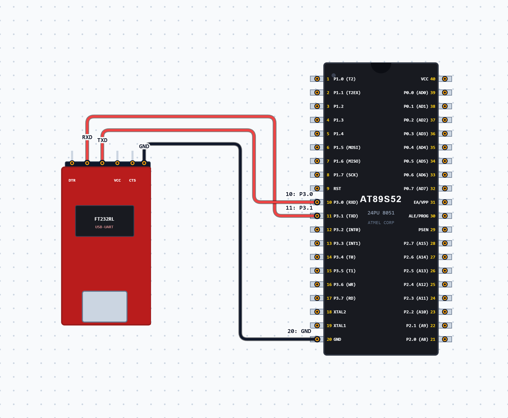
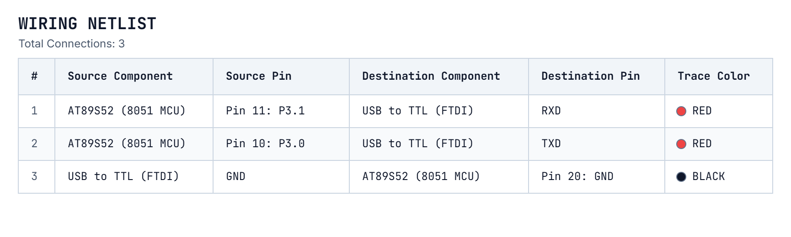

[← Back to 8051 Index](../../README.md) | [← Back to Root Repository](../../../README.md)

# CAT-6 TASK-6A

| Field | Details |
| :--- | :--- |
| **EXP** | Continuous Lab Evaluation-6 (`CAT6` / `TASK6A`) |
| **TASK NO** | **Task 6A — UART Initialization & Character Transmission** |
| **DATE** | 21/08/2026 |
| **NAME OF EXP** | UART Driver and Serial Debugging |

## HARDWARE SETUP / PLATFORM
- **Development Board:** 8051 Development Board
- **Microcontroller IC & Model:** Atmel `AT89S52` (8-bit 8051 Architecture, 11.0592 MHz Crystal)
- **Toolchain / IDE:** Keil µVision (`toPC.uvproj`)
- **Firmware Approach:** Bare-metal Embedded C with direct SFR UART and Timer register access (`<reg51.h>`)
- **Peripherals:** USB-to-TTL Serial Converter and PC Serial Terminal (PuTTY / Tera Term)
- **Pin Mapping:**
  - `P3.1` (`TXD`) — UART serial transmit output (connected to USB-to-TTL `RX`)

## Circuit Diagram

### Hardware Schematic

### Wiring Interconnects Table

## Core Logic / Pseudocode / Code Base

### Working Principle
- `Timer 1` is configured in **Mode 2 (8-bit auto-reload)** via `TMOD = 0x20` with `TH1 = 0xFD`, generating a standard `9600` baud clock when driven by an `11.0592 MHz` crystal oscillator.
- The Serial Control register is set to `SCON = 0x50` (**UART Mode 1**: 8 data bits, 1 start bit, 1 stop bit, variable baud rate clocked by Timer 1, receiver enabled) and `TR1 = 1` starts the baud-rate generator.
- Inside the continuous `while(1)` loop, loading `'A'` (`0x41`) into `SBUF` initiates asynchronous serial transmission on `P3.1` (`TXD`). The firmware polls the Transmit Interrupt flag (`while(TI == 0);`) until framing completes and clears `TI = 0` in software before sending the next character.

### Pseudocode
- Configure `TMOD = 0x20` (Timer 1, 8-bit auto-reload mode).
- Load `TH1 = 0xFD` to set the `9600` baud rate (`11.0592 MHz` crystal).
- Configure `SCON = 0x50` (8-bit UART Mode 1) and start Timer 1 (`TR1 = 1`).
- Continuously loop in `while(1)`:
  - Write `'A'` to `SBUF` to begin serial transmission over `P3.1` (`TXD`).
  - Poll `while(TI == 0);` until the 8-bit frame finishes shifting out.
  - Clear `TI = 0` in software to prepare for the next byte.

### Code Base
Project files in `8051/CAT6/TASK6A/`:
- `toPC.uvproj` & `STARTUP.A51` – Keil µVision project configuration and 8051 startup code.
- `main.c` – Configures `TMOD`, `TH1`, `SCON`, and `TR1` for 9600-8-N-1 UART operation and transmits `'A'` continuously via `SBUF` and `TI` polling.

## INFERENCE
- Configured the AT89S52 hardware UART (`SCON = 0x50`) and `Timer 1` auto-reload baud-rate generator (`TMOD = 0x20`, `TH1 = 0xFD`) at `9600` baud without high-level libraries.
- Verified continuous character transmission (`'A'`) from `P3.1` (`TXD`) to a PC serial terminal using `SBUF` writes and `TI` flag polling.
