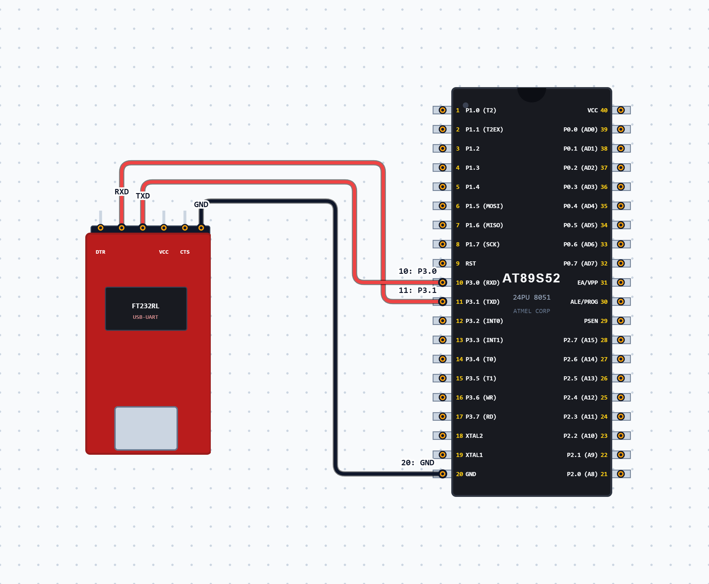
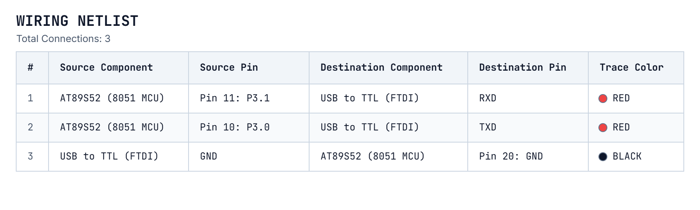

[← Back to 8051 Index](../../README.md) | [← Back to Root Repository](../../../README.md)

# CAT-6 TASK-6B

| Field | Details |
| :--- | :--- |
| **EXP** | Continuous Lab Evaluation-6 (`CAT6` / `TASK6B`) |
| **TASK NO** | **Task 6B — Full-Duplex UART Echo** |
| **DATE** | 21/08/2026 |
| **NAME OF EXP** | UART Driver and Serial Debugging |

## HARDWARE SETUP / PLATFORM
- **Development Board:** 8051 Development Board
- **Microcontroller IC & Model:** Atmel `AT89S52` (8-bit 8051 Architecture, 11.0592 MHz Crystal)
- **Toolchain / IDE:** Keil µVision (`fromPC.uvproj`)
- **Firmware Approach:** Bare-metal Embedded C with direct SFR UART and Timer register access (`<reg51.h>`)
- **Peripherals:** USB-to-TTL Serial Converter and PC Serial Terminal (PuTTY / Tera Term)
- **Pin Mapping:**
  - `P3.1` (`TXD`) — UART serial transmit output (connected to USB-to-TTL `RX`)
  - `P3.0` (`RXD`) — UART serial receive input (connected to USB-to-TTL `TX`)

## Circuit Diagram

### Hardware Schematic

### Wiring Interconnects Table

## Core Logic / Pseudocode / Code Base

### Working Principle
- `Timer 1` is configured in **Mode 2 (8-bit auto-reload)** via `TMOD = 0x20` with reload value `TH1 = 0xFA` (`4800` baud at `11.0592 MHz`), while `SCON = 0x50` enables **UART Mode 1** (8-N-1) with receiver enabled (`REN = 1`) and `TR1 = 1` starts the baud-rate clock.
- Inside the continuous `while(1)` loop, the firmware blocks on the Receive Interrupt flag (`while(RI == 0);`) until a serial byte arrives on `P3.0` (`RXD`).
- Once received, the byte is read from `SBUF` into `ch`, `RI` is cleared in software (`RI = 0`), and `ch` is immediately written back to `SBUF` to echo the character over `P3.1` (`TXD`), polling `TI` until transmission completes.

### Pseudocode
- Configure `TMOD = 0x20` (Timer 1, 8-bit auto-reload mode) and load `TH1 = 0xFA` (`4800` baud at `11.0592 MHz`).
- Configure `SCON = 0x50` (8-bit UART Mode 1 with receiver enabled) and start Timer 1 (`TR1 = 1`).
- Continuously loop in `while(1)`:
  - Poll `while(RI == 0);` until an incoming character arrives on `P3.0` (`RXD`).
  - Read `ch = SBUF` and clear `RI = 0`.
  - Write `SBUF = ch` to transmit the character back on `P3.1` (`TXD`).
  - Poll `while(TI == 0);` and clear `TI = 0`.

### Code Base
Project files in `8051/CAT6/TASK6B/`:
- `fromPC.uvproj` & `STARTUP.A51` – Keil µVision project configuration and 8051 startup code.
- `main.c` – Configures full-duplex UART (`TMOD = 0x20`, `TH1 = 0xFA`, `SCON = 0x50`) and echoes every received `SBUF` byte back to the PC terminal using `RI` and `TI` polling.

## INFERENCE
- Implemented full-duplex bidirectional UART communication on the AT89S52 using `P3.0` (`RXD`) and `P3.1` (`TXD`).
- Verified real-time character reception (`RI` flag polling + `SBUF` read) and loopback transmission (`SBUF` write + `TI` flag polling) with a PC serial terminal.
