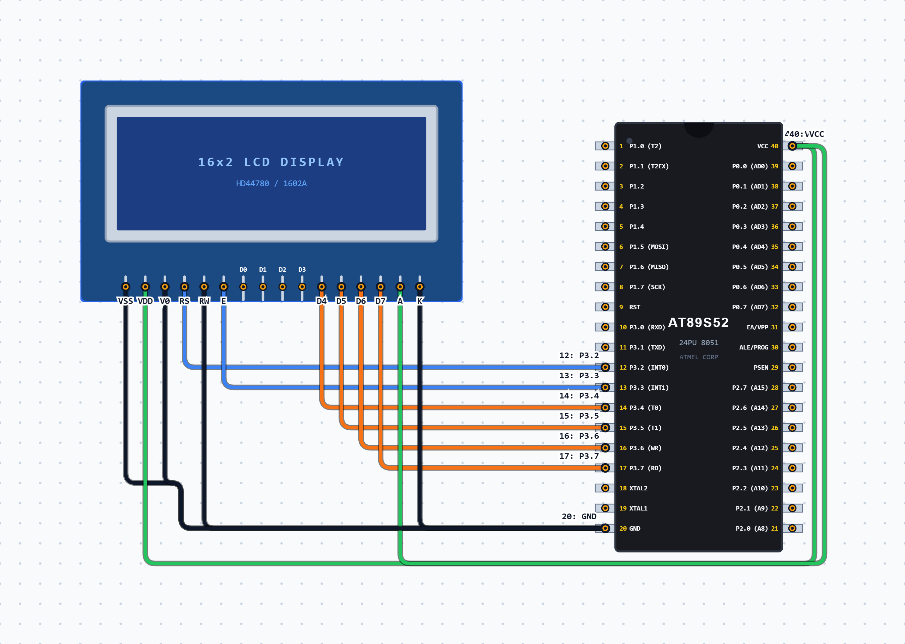
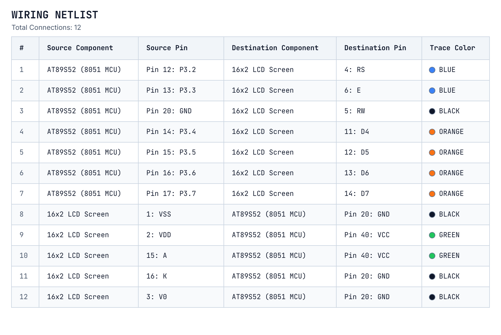

[← Back to 8051 Index](../../README.md) | [← Back to Root Repository](../../../README.md)

# CAT-7 TASK-7A

| Field | Details |
| :--- | :--- |
| **EXP** | Continuous Lab Evaluation-7 (`CAT7` / `TASK7A`) |
| **TASK NO** | **Task 7A — 4-Bit LCD Initialization & Character/String Display** |
| **DATE** | 28/08/2026 |
| **NAME OF EXP** | 16×2 LCD Driver Development and Dynamic Display Control |

## HARDWARE SETUP / PLATFORM
- **Development Board:** 8051 Development Board
- **Microcontroller IC & Model:** Atmel `AT89S52` (8-bit 8051 Architecture)
- **Toolchain / IDE:** Keil µVision (`lcd_display.uvproj`)
- **Firmware Approach:** Bare-metal Embedded C with direct SFR port and bit access (`<reg51.h>`)
- **Peripherals:** 16×2 Character LCD (HD44780-compatible, 4-bit interface mode)
- **Pin Mapping:**
  - `P3.2` — LCD Register Select (`RS`)
  - `P3.3` — LCD Enable (`EN`)
  - `P3.4`–`P3.7` — LCD 4-bit data bus (`D4`–`D7`)

## Circuit Diagram

### Hardware Schematic

### Wiring Interconnects Table

## Core Logic / Pseudocode / Code Base

### Working Principle
- The 16×2 HD44780 LCD operates in **4-bit interface mode** using `Port 3`, where `P3.2` drives `RS` (`0` = instruction, `1` = character data), `P3.3` pulses `EN` (`lcd_pulse()`), and `P3.4`–`P3.7` carry each byte split into high nibble followed by low nibble (`lcd_send_nibble()`).
- `lcd_init()` executes the standard HD44780 4-bit reset sequence (`0x30` ×3, then `0x20`) followed by configuration commands: `0x28` (4-bit, 2-line, 5×8 font), `0x0C` (display ON, cursor OFF), `0x06` (auto-increment cursor), and `0x01` (clear display).
- `main()` writes single characters (`'A'` at `0x80`, `'B'` at `0xC0`) via `lcd_putc()`, then overwrites both lines with null-terminated strings (`"ABC"` on Line 1 at `0x80`, `"DEF"` on Line 2 at `0xC0`) using `lcd_puts()`.

### Pseudocode
- Call `lcd_init()` to initialize `RS = 0`, `EN = 0`, switch the LCD into 4-bit mode (`0x30`, `0x30`, `0x30`, `0x20`), and configure `0x28`, `0x0C`, `0x06`, and `0x01`.
- Set DDRAM cursor to Row 1, Column 0 (`lcd_cmd(0x80)`) and display `'A'` (`lcd_putc('A')`).
- Set DDRAM cursor to Row 2, Column 0 (`lcd_cmd(0xC0)`) and display `'B'` (`lcd_putc('B')`).
- Return cursor to Row 1 (`0x80`) and write `"ABC"` via `lcd_puts("ABC")`.
- Move cursor to Row 2 (`0xC0`) and write `"DEF"` via `lcd_puts("DEF")`.
- Halt in `while(1);`.

### Code Base
Project files in `8051/CAT7/TASK7A/`:
- `lcd_display.uvproj` & `STARTUP.A51` – Keil µVision project configuration and 8051 startup code.
- `main.c` – Implements the 4-bit HD44780 LCD driver (`delay_ms`, `lcd_pulse`, `lcd_send_nibble`, `lcd_cmd`, `lcd_putc`, `lcd_init`, `lcd_puts`) and renders characters and strings across both display rows.

## INFERENCE
- Developed a bare-metal 4-bit HD44780 16×2 LCD driver on `Port 3` of the AT89S52 without external libraries.
- Verified nibble-splitting data transfers, HD44780 initialization commands (`0x28`, `0x0C`, `0x06`, `0x01`), DDRAM row addressing (`0x80` and `0xC0`), and string output (`"ABC"` / `"DEF"`).
