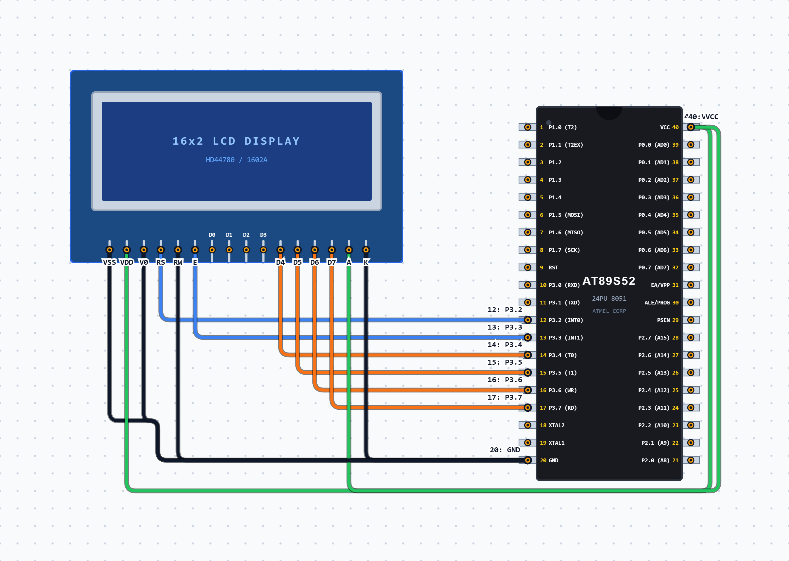
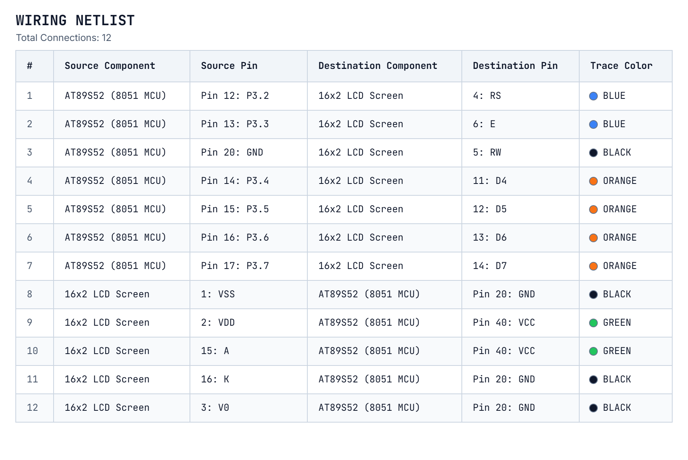

[← Back to 8051 Index](../../README.md) | [← Back to Root Repository](../../../README.md)

# CAT-7 TASK-7B

| Field | Details |
| :--- | :--- |
| **EXP** | Continuous Lab Evaluation-7 (`CAT7` / `TASK7B`) |
| **TASK NO** | **Task 7B — Cursor Positioning & Dynamic Numeric Output** |
| **DATE** | 28/08/2026 |
| **NAME OF EXP** | 16×2 LCD Driver Development and Dynamic Display Control |

## HARDWARE SETUP / PLATFORM
- **Development Board:** 8051 Development Board
- **Microcontroller IC & Model:** Atmel `AT89S52` (8-bit 8051 Architecture)
- **Toolchain / IDE:** Keil µVision (`lcd_cursor.uvproj`)
- **Firmware Approach:** Bare-metal Embedded C with direct SFR port and bit access (`<reg51.h>`)
- **Peripherals:** 16×2 Character LCD (HD44780-compatible, 4-bit interface mode)
- **Pin Mapping:**
  - `P3.2` — LCD Register Select (`RS`)
  - `P3.3` — LCD Enable (`EN`)
  - `P3.4`–`P3.7` — LCD 4-bit data bus (`D4`–`D7`)

## Circuit Diagram

### Hardware Schematic

### Wiring Interconnects Table

## Core Logic / Pseudocode / Code Base

### Working Principle
- Extends the 4-bit HD44780 LCD driver on `Port 3` (`P3.2` `RS`, `P3.3` `EN`, `P3.4`–`P3.7` `D4`–`D7`) with two-dimensional `(row, col)` DDRAM cursor addressing and integer-to-ASCII formatting.
- `lcd_goto(row, col)` computes the exact DDRAM address command (`0x80 + col` for Row `0` and `0xC0 + col` for Row `1`) to position text anywhere on the 16×2 screen without clearing existing content.
- `lcd_print_number(num)` converts an unsigned 16-bit integer (`0`–`65535`) into ASCII digits by dividing sequentially by powers of `10` (`10000` down to `1`), suppressing leading zeroes via the `started` flag.
- `main()` displays `"HI"` at `(0, 0)`, `"There"` at `(1, 3)`, and the integer `13` at `(0, 8)`.

### Pseudocode
- Initialize the 16×2 LCD in 4-bit mode via `lcd_init()`.
- Move cursor to Row `0`, Column `0` (`lcd_goto(0, 0)`) and print `"HI"` (`lcd_puts("HI")`).
- Move cursor to Row `1`, Column `3` (`lcd_goto(1, 3)`) and print `"There"` (`lcd_puts("There")`).
- Move cursor to Row `0`, Column `8` (`lcd_goto(0, 8)`) and render `13` via `lcd_print_number(13)`.
- Halt in `while(1);`.

### Code Base
Project files in `8051/CAT7/TASK7B/`:
- `lcd_cursor.uvproj` & `STARTUP.A51` – Keil µVision project configuration and 8051 startup code.
- `main.c` – Implements the 4-bit LCD driver (`lcd_init`, `lcd_cmd`, `lcd_putc`, `lcd_puts`), DDRAM cursor positioning (`lcd_goto`), and integer-to-ASCII display formatting (`lcd_print_number`).

## INFERENCE
- Implemented arbitrary `(row, col)` DDRAM cursor addressing (`0x80 + col` / `0xC0 + col`) on the 16×2 LCD using bare-metal 4-bit transfers on `Port 3`.
- Verified leading-zero-suppressed integer-to-ASCII conversion (`lcd_print_number`) alongside multi-position string rendering across both display rows.
