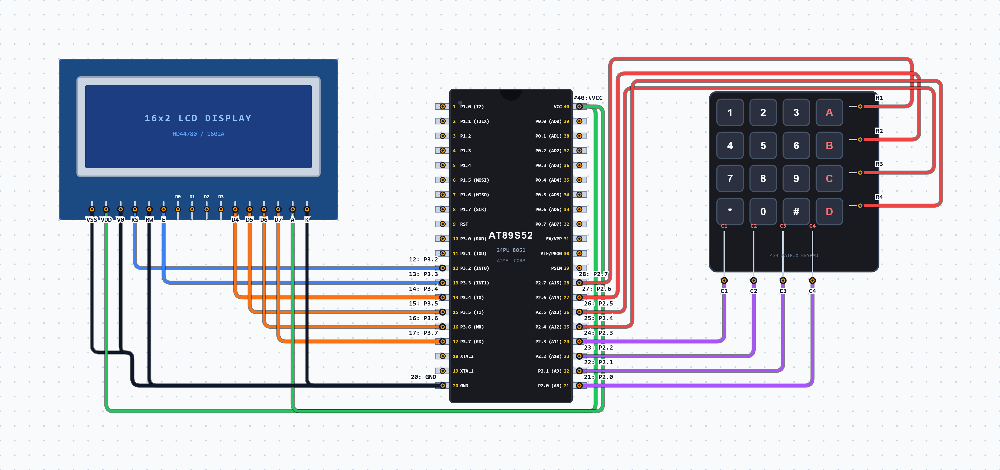
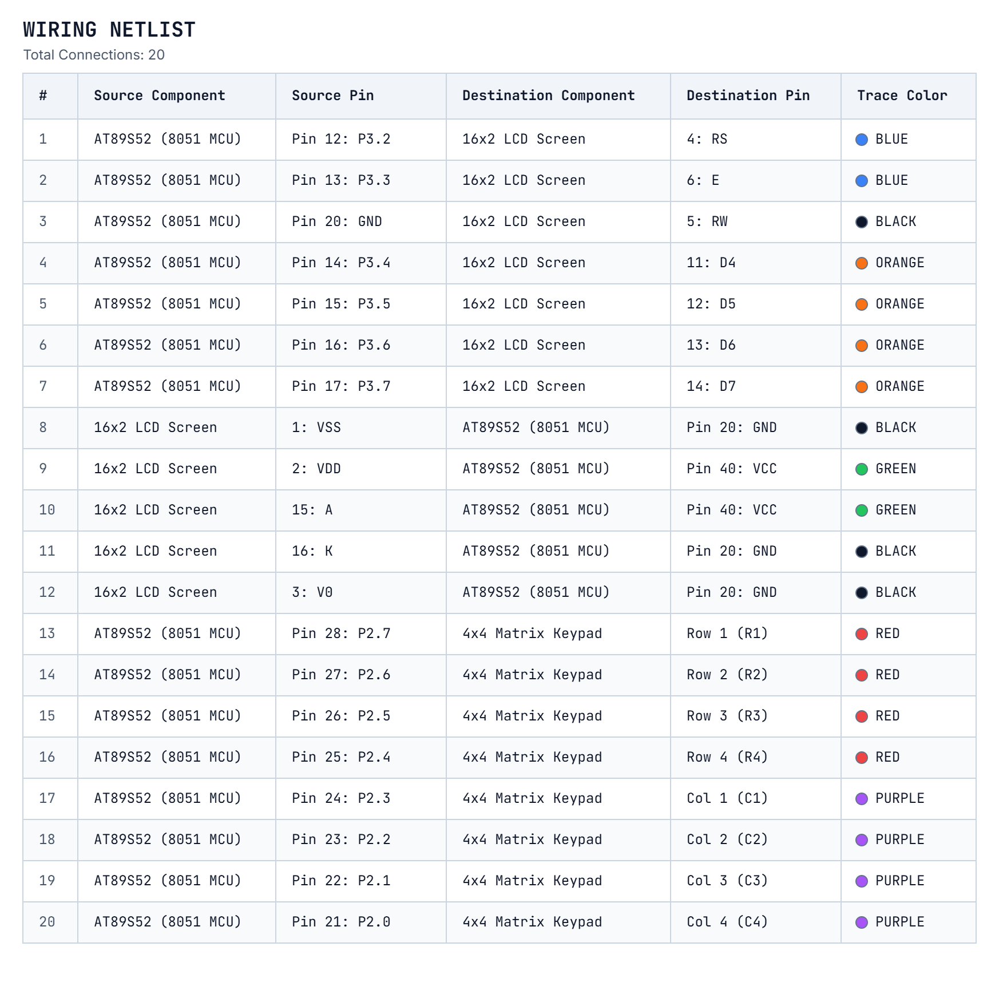

[← Back to 8051 Index](../../README.md) | [← Back to Root Repository](../../../README.md)

# CAT-7 TASK-7C

| Field | Details |
| :--- | :--- |
| **EXP** | Continuous Lab Evaluation-7 (`CAT7` / `TASK7C`) |
| **TASK NO** | **Task 7C — 4×4 Keypad-Controlled Character Navigation on 16×2 LCD** |
| **DATE** | 28/08/2026 |
| **NAME OF EXP** | 16×2 LCD Driver Development and Dynamic Display Control |

## HARDWARE SETUP / PLATFORM
- **Development Board:** 8051 Development Board
- **Microcontroller IC & Model:** Atmel `AT89S52` (8-bit 8051 Architecture)
- **Toolchain / IDE:** Keil µVision (`lcd_keypad.uvproj`)
- **Firmware Approach:** Bare-metal Embedded C with direct SFR port and bit access (`<reg51.h>`)
- **Peripherals:** 16×2 Character LCD (HD44780-compatible, 4-bit mode) and 4×4 Matrix Keypad
- **Pin Mapping:**
  - `P3.2` — LCD Register Select (`RS`)
  - `P3.3` — LCD Enable (`EN`)
  - `P3.4`–`P3.7` — LCD 4-bit data bus (`D4`–`D7`)
  - `P2.7`–`P2.4` — Matrix keypad row scan outputs (`R1`–`R4`)
  - `P2.3`–`P2.0` — Matrix keypad column sense inputs (`C1`–`C4`)

## Circuit Diagram

### Hardware Schematic

### Wiring Interconnects Table

## Core Logic / Pseudocode / Code Base

### Working Principle
- Combines the 4-bit HD44780 LCD driver on `Port 3` (`P3.2` `RS`, `P3.3` `EN`, `P3.4`–`P3.7` `D4`–`D7`) with a 4×4 matrix keypad scanner on `Port 2` (`r1`–`r4` on `P2.7`–`P2.4`, `c1`–`c4` on `P2.3`–`P2.0`).
- `keypad_scan()` drives rows `R1`, `R2`, and `R3` LOW one at a time and polls columns `C1`–`C3` with a `20 ms` debounce and release wait to detect directional keys (`2`, `4`, `6`, `8`).
- `move_character(key)` erases the current `*` at `(row, col)` by writing `' '`, updates coordinates with wrap-around boundaries (`row` `0 ↔ 1`, `col` `0 ↔ 15`), and redraws `*` at the new DDRAM position:
  - **Key `2` (Up):** Toggles `row` (`0 ↔ 1`).
  - **Key `8` (Down):** Toggles `row` (`1 ↔ 0`).
  - **Key `4` (Left):** Decrements `col` (`0` wraps to `15`).
  - **Key `6` (Right):** Increments `col` (`15` wraps to `0`).

### Pseudocode
- Initialize `P2 = 0xFF`, `P3 = 0x00`, call `lcd_init()`, set `row = 0`, `col = 0`, and draw initial `'*'` at `(0, 0)`.
- Continuously loop in `while(1)`:
  - Call `keypad_scan()` to detect directional keys `2` (`R1,C2`), `4` (`R2,C1`), `6` (`R2,C3`), or `8` (`R3,C2`) with `20 ms` debounce.
  - When a valid directional key (`2`, `4`, `6`, `8`) is returned, call `move_character(key)`:
    - Write `' '` at current `(row, col)` to erase the previous marker.
    - Update `row` (`0 ↔ 1`) or `col` (`0 ↔ 15` wrap-around) according to `key`.
    - Move cursor via `lcd_goto(row, col)` and write `'*'`.

### Code Base
Project files in `8051/CAT7/TASK7C/`:
- `lcd_keypad.uvproj` & `STARTUP.A51` – Keil µVision project configuration and 8051 startup code.
- `main.c` – Implements `keypad_scan()` (`Port 2` directional key decoder), 4-bit LCD routines (`lcd_init`, `lcd_cmd`, `lcd_putc`, `lcd_goto`), and `move_character()` wrap-around cursor updates.

## INFERENCE
- Integrated a 4×4 matrix keypad (`Port 2`) and a 16×2 LCD (`Port 3`) on the AT89S52 to build an interactive real-time cursor movement interface.
- Verified debounced directional key decoding (`2`, `4`, `6`, `8`), erase-and-redraw DDRAM updates (`lcd_goto`), and seamless row/column wrap-around navigation across all 32 character cells (`2 × 16`).
