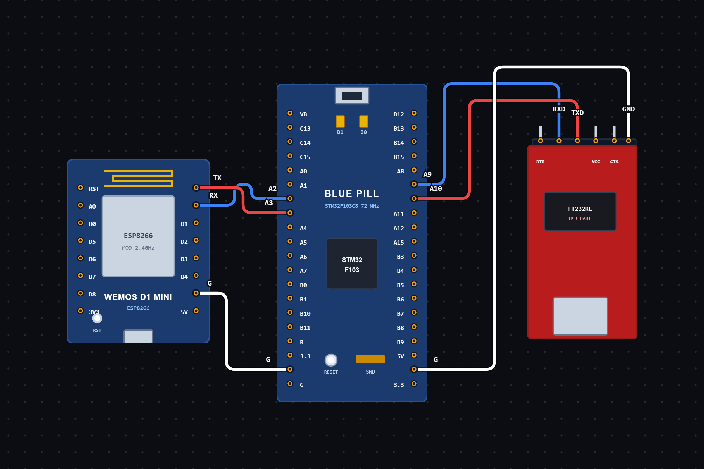
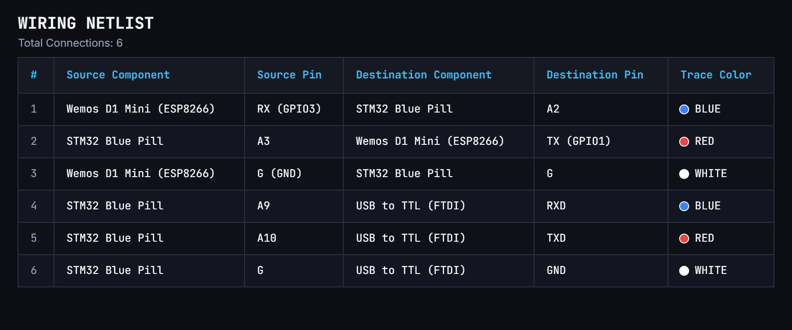

[← Back to STM32 Index](../../README.md) | [← Back to Root Repository](../../../README.md)

# CAT-10 TASK-10A

| Field | Details |
| :--- | :--- |
| **EXP** | Continuous Lab Evaluation-10 (`CAT10` / `TASK10A`) |
| **TASK NO** | **Task 10A — Establish STM32 ↔ Wemos UART Communication** |
| **DATE** | 09/10/2026 |
| **NAME OF EXP** | STM32–Wemos Wi-Fi Modem Interface Using AT Commands |

## HARDWARE SETUP / PLATFORM
- **Development Board:** STM32 Blue Pill (`STM32F103C8T6`) (ARM Cortex-M3, 72 MHz SYSCLK)
- **Toolchain / IDE:** STM32CubeMX + Keil MDK-ARM
- **Firmware Libraries:** STM32F1xx HAL Drivers, CMSIS
- **Peripherals:** Wemos D1 Mini (ESP8266 Wi-Fi Module), USB-to-TTL Serial Converter, and PC Serial Terminal
- **Pin Mapping:**
  - `PA2` (`USART2_TX`) — Connected to Wemos D1 Mini `RX`
  - `PA3` (`USART2_RX`) — Connected to Wemos D1 Mini `TX`
  - `PA9` (`USART1_TX`) — Connected to USB-to-TTL `RX` (PC debug output)
  - `PA10` (`USART1_RX`) — Connected to USB-to-TTL `TX`

## Circuit Diagram

### Hardware Schematic

### Wiring Interconnects Table

## Core Logic / Pseudocode / Code Base

### Working Principle
- Two UART peripherals (`USART1` and `USART2`) are initialized at `115200` baud (8-N-1) to bridge communication between the Wemos D1 Mini (ESP8266) and the PC serial terminal.
- `USART2` (`PA2`/`PA3`) acts as the modem link to the Wemos D1 Mini, transmitting the basic test command `"AT\r\n"` and capturing the module's reply into `rx_data1`.
- `USART1` (`PA9`/`PA10`) forwards the captured response buffer to the PC terminal so the `"OK"` handshake can be verified.

### Pseudocode
- Initialize HAL (`HAL_Init`), 72 MHz system clock (`SystemClock_Config`), GPIO (`MX_GPIO_Init`), `USART1` (`MX_USART1_UART_Init`), and `USART2` (`MX_USART2_UART_Init`).
- Transmit `"AT\r\n"` (4 bytes) to the Wemos D1 Mini over `USART2` using `HAL_UART_Transmit()`.
- Read the incoming response bytes from `USART2` into `rx_data1` via `HAL_UART_Receive()`.
- Forward `rx_data1` to the PC serial terminal over `USART1` using `HAL_UART_Transmit()`.

### Code Base
Key functions in `Core/Src/main.c`:
- `HAL_Init()` – Initializes HAL library and SysTick timer.
- `SystemClock_Config()` – Configures 72 MHz system clock (HSE + PLL ×9).
- `MX_GPIO_Init()` – Enables `GPIOA` and `GPIOD` peripheral clocks.
- `MX_USART1_UART_Init()` – Configures `USART1` (115200 baud, 8-N-1) for PC terminal debug output.
- `MX_USART2_UART_Init()` – Configures `USART2` (115200 baud, 8-N-1) for Wemos D1 Mini AT command communication.
- `HAL_UART_Transmit()` – Sends `"AT\r\n"` to the Wemos via `huart2` and forwards the reply to the PC via `huart1`.
- `HAL_UART_Receive()` – Receives the AT response from the Wemos module over `huart2`.

## INFERENCE
- Established dual-UART serial bridging on STM32F103C8T6 (`USART2` to Wemos D1 Mini and `USART1` to PC terminal) at 115200 baud.
- Verified physical wiring and AT command responsiveness by transmitting `AT\r\n` and relaying the Wemos D1 Mini's `OK` reply to the PC monitor.
