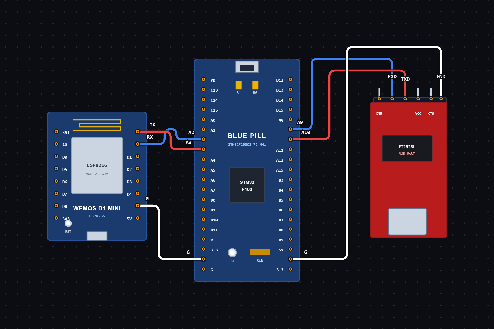
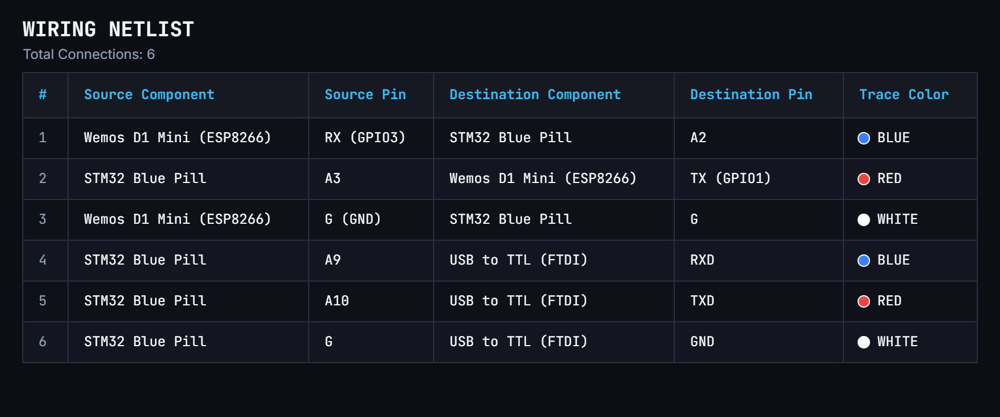

[← Back to STM32 Index](../../README.md) | [← Back to Root Repository](../../../README.md)

# CAT-10 TASK-10B

| Field | Details |
| :--- | :--- |
| **EXP** | Continuous Lab Evaluation-10 (`CAT10` / `TASK10B`) |
| **TASK NO** | **Task 10B — Explore the ESP8266 AT Command Interface** |
| **DATE** | 09/10/2026 |
| **NAME OF EXP** | STM32–Wemos Wi-Fi Modem Interface Using AT Commands |

## HARDWARE SETUP / PLATFORM
- **Development Board:** STM32 Blue Pill (`STM32F103C8T6`) (ARM Cortex-M3, 72 MHz SYSCLK)
- **Toolchain / IDE:** STM32CubeMX + Keil MDK-ARM
- **Firmware Libraries:** STM32F1xx HAL Drivers, CMSIS
- **Peripherals:** Wemos D1 Mini (ESP8266 Wi-Fi Module), USB-to-TTL Serial Converter, and PC Serial Terminal
- **Pin Mapping:**
  - `PA2` (`USART2_TX`) — Connected to Wemos D1 Mini `RX`
  - `PA3` (`USART2_RX`) — Connected to Wemos D1 Mini `TX`
  - `PA9` (`USART1_TX`) — Connected to USB-to-TTL `RX` (PC debug output)
  - `PA10` (`USART1_RX`) — Connected to USB-to-TTL `TX`

## Circuit Diagram

### Hardware Schematic

### Wiring Interconnects Table

## Core Logic / Pseudocode / Code Base

### Working Principle
- Uses dual-UART serial bridging (`USART2` at `115200` baud to the Wemos D1 Mini and `USART1` at `115200` baud to the PC terminal) to test and verify the ESP8266 AT command interface.
- Each command terminated with `\r\n` is transmitted over `USART2` and its response is echoed back to the PC terminal via `USART1`:
  - `AT` — Verifies modem communication (`OK`).
  - `AT+GMR` — Queries AT and SDK firmware version details.
  - `AT+CWMODE=1` — Sets the ESP8266 to Wi-Fi Station (`STA`) mode.
  - `AT+CWLAP` — Scans and lists nearby Wi-Fi Access Points.
  - `AT+CWJAP` — Connects the module to a target Wi-Fi network.
  - `AT+CIFSR` — Retrieves the assigned local IP and MAC addresses.
  - `AT+CIPSTART` / `AT+CIPSEND` — Establishes a TCP connection and transmits application data.

## INFERENCE
- Investigated and verified the ESP8266 AT command set (`AT`, `AT+GMR`, `AT+CWMODE`, `AT+CWLAP`, `AT+CWJAP`, `AT+CIFSR`, `AT+CIPSTART`, `AT+CIPSEND`) via STM32 dual-UART communication.
- Confirmed firmware version reporting, Wi-Fi station mode configuration, and access point scanning on the Wemos D1 Mini through the PC serial terminal.
