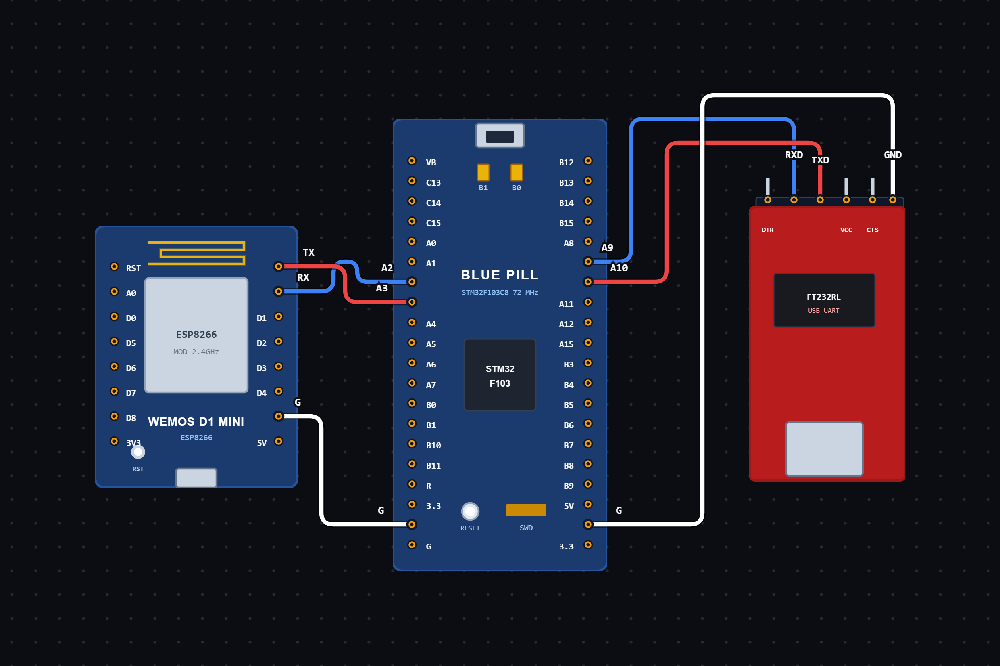
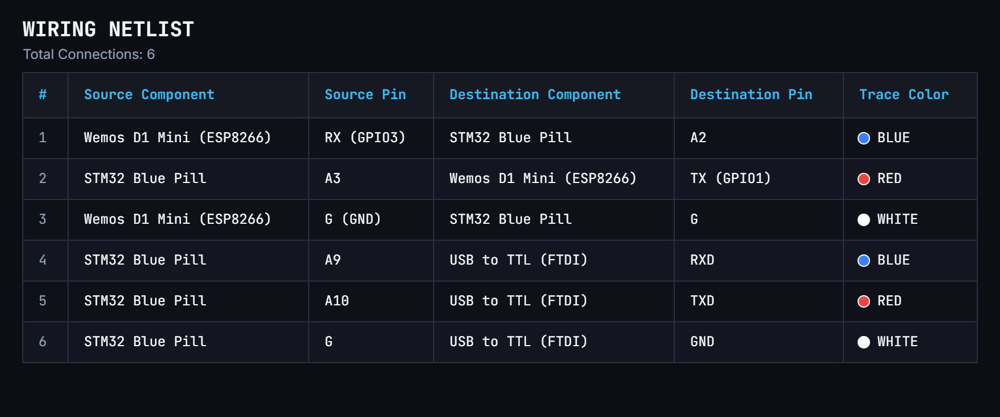

[← Back to STM32 Index](../../README.md) | [← Back to Root Repository](../../../README.md)

# CAT-10 TASK-10C

| Field | Details |
| :--- | :--- |
| **EXP** | Continuous Lab Evaluation-10 (`CAT10` / `TASK10C`) |
| **TASK NO** | **Task 10C — Connect Wemos to Wi-Fi** |
| **DATE** | 09/10/2026 |
| **NAME OF EXP** | STM32–Wemos Wi-Fi Modem Interface Using AT Commands |

## HARDWARE SETUP / PLATFORM
- **Development Board:** STM32 Blue Pill (`STM32F103C8T6`) (ARM Cortex-M3, 72 MHz SYSCLK)
- **Toolchain / IDE:** STM32CubeMX + Keil MDK-ARM
- **Firmware Libraries:** STM32F1xx HAL Drivers, CMSIS
- **Peripherals:** Wemos D1 Mini (ESP8266 Wi-Fi Module), USB-to-TTL Serial Converter, and PC Serial Terminal
- **Pin Mapping:**
  - `PA2` (`USART2_TX`) — Connected to Wemos D1 Mini `RX`
  - `PA3` (`USART2_RX`) — Connected to Wemos D1 Mini `TX`
  - `PA9` (`USART1_TX`) — Connected to USB-to-TTL `RX` (PC debug output)
  - `PA10` (`USART1_RX`) — Connected to USB-to-TTL `TX`

## Circuit Diagram

### Hardware Schematic

### Wiring Interconnects Table

## Core Logic / Pseudocode / Code Base

### Working Principle
- `USART2` (`115200` baud) communicates with the Wemos D1 Mini (ESP8266), while `USART1` (`115200` baud) streams real-time modem responses to the PC terminal.
- After a `2000 ms` startup delay, the STM32 sequentially transmits six AT commands over `USART2` to configure Wi-Fi Station mode, connect to the local Access Point, query the assigned IP address, and initialize a multi-connection TCP server:
  1. `AT\r\n` — Verifies modem readiness.
  2. `AT+CWMODE=1\r\n` — Configures Wi-Fi Station (`STA`) mode.
  3. `AT+CWJAP=<SSID>,<PASSWORD>\r\n` — Joins the target Wi-Fi network.
  4. `AT+CIFSR\r\n` — Queries the assigned local IP address.
  5. `AT+CIPMUX=1\r\n` — Enables multiple TCP connections.
  6. `AT+CIPSERVER=1,80\r\n` — Starts a TCP server on port `80`.
- Before each command, `clear_buffer()` zeroes `rx_data` (`800` bytes). After transmission, `receive_response()` reads bytes from `USART2`, forwards every character immediately to `USART1`, and exits once `"OK"`, `"ERROR"`, or `"FAIL"` is detected.

### Pseudocode
- Initialize HAL (`HAL_Init`), 72 MHz clock (`SystemClock_Config`), GPIO (`MX_GPIO_Init`), `USART1`, and `USART2`.
- Wait `2000 ms` (`HAL_Delay(2000)`) for the ESP8266 module to boot.
- For each AT command (`AT`, `AT+CWMODE=1`, `AT+CWJAP`, `AT+CIFSR`, `AT+CIPMUX=1`, `AT+CIPSERVER=1,80`):
  - Call `clear_buffer()` to reset `rx_data` and `array_index`.
  - Transmit the command string over `USART2` via `HAL_UART_Transmit()`.
  - Call `receive_response()` to read incoming bytes from `USART2`, forward them to `USART1`, and break when `"OK"`, `"ERROR"`, or `"FAIL"` arrives.

### Code Base
Key functions in `Core/Src/main.c`:
- `HAL_Init()` – Initializes HAL library and SysTick timer.
- `SystemClock_Config()` – Configures 72 MHz system clock (HSE + PLL ×9).
- `MX_GPIO_Init()` – Enables `GPIOA` and `GPIOD` peripheral clocks.
- `MX_USART1_UART_Init()` – Configures `USART1` (115200 baud, 8-N-1) for PC debug forwarding.
- `MX_USART2_UART_Init()` – Configures `USART2` (115200 baud, 8-N-1) for Wemos D1 Mini communication.
- `clear_buffer()` – Clears `rx_data` using `memset()` and resets `array_index` to `0`.
- `receive_response()` – Reads bytes from `huart2`, forwards them to `huart1`, and checks `rx_data` with `strstr()` for `"OK"`, `"ERROR"`, or `"FAIL"`.
- `HAL_UART_Transmit()` / `HAL_UART_Receive()` – Executes blocking UART transfers between STM32, ESP8266, and PC.

## INFERENCE
- Automated Wi-Fi station configuration, Access Point association, IP address retrieval (`AT+CIFSR`), and TCP server setup (`AT+CIPSERVER=1,80`) on the Wemos D1 Mini from the STM32F103C8T6.
- Verified reliable AT command sequencing by parsing response terminators (`OK`, `ERROR`, `FAIL`) via `strstr()` while streaming live responses to the PC serial terminal.
