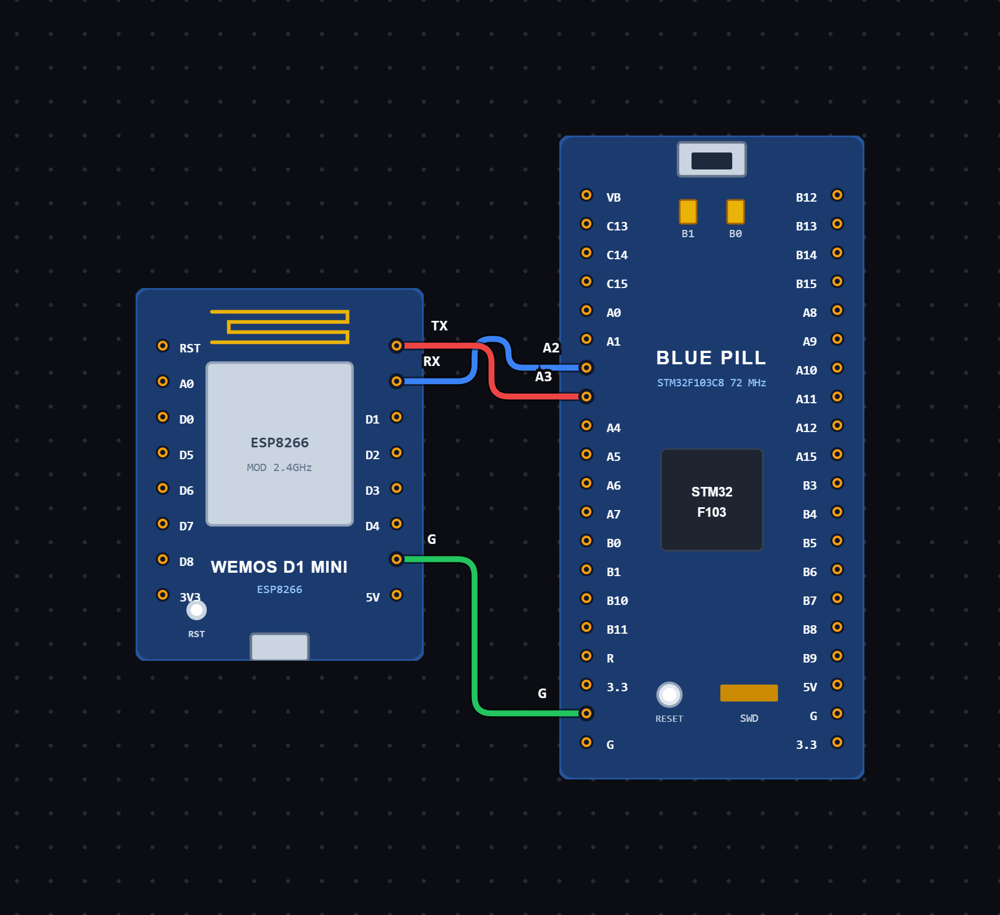
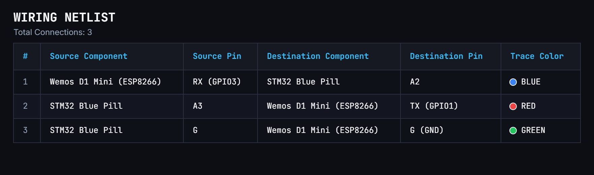

[← Back to STM32 Index](../../README.md) | [← Back to Root Repository](../../../README.md)

# CAT-11 TASK-11A

| Field | Details |
| :--- | :--- |
| **EXP** | Continuous Lab Evaluation-11 (`CAT11` / `TASK11A`) |
| **TASK NO** | **Task 11A — TCP Server Setup & IP Retrieval** |
| **DATE** | 22/10/2026 |
| **NAME OF EXP** | HTTP Server - STM32–Wemos Wi-Fi Modem Using AT Commands |

## HARDWARE SETUP / PLATFORM
- **Development Board:** STM32 Blue Pill (`STM32F103C8T6`) (ARM Cortex-M3, 72 MHz SYSCLK)
- **Toolchain / IDE:** STM32CubeMX + Keil MDK-ARM
- **Firmware Libraries:** STM32F1xx HAL Drivers, CMSIS
- **Peripherals:** Wemos D1 Mini (ESP8266 Wi-Fi Module)
- **Pin Mapping:**
  - `PA2` (`USART2_TX`) — Connected to Wemos D1 Mini `RX`
  - `PA3` (`USART2_RX`) — Connected to Wemos D1 Mini `TX`

## Circuit Diagram

### Hardware Schematic

### Wiring Interconnects Table

## Core Logic / Pseudocode / Code Base

### Working Principle
- `USART2` (`115200` baud, 8-N-1) connects the STM32 Blue Pill directly to the Wemos D1 Mini (ESP8266) AT command interface.
- After a `2000 ms` startup delay, the firmware sequentially transmits six AT commands over `USART2` to connect to Wi-Fi, retrieve the local IP address, and start a multi-connection TCP server on port `80`:
  1. `AT\r\n` — Verifies modem readiness.
  2. `AT+CWMODE=1\r\n` — Configures Wi-Fi Station (`STA`) mode.
  3. `AT+CWJAP="<SSID>","<PASSWORD>"\r\n` — Associates with the target Wi-Fi Access Point.
  4. `AT+CIFSR\r\n` — Retrieves the assigned local IP address.
  5. `AT+CIPMUX=1\r\n` — Enables multi-connection mode required for server operation.
  6. `AT+CIPSERVER=1,80\r\n` — Starts the TCP server listening on port `80`.
- `receive_response()` captures incoming bytes into `rx_data` and terminates as soon as `"OK"`, `"ERROR"`, `"FAIL"`, or `"<"` is matched via `strstr()`.

### Pseudocode
- Initialize HAL (`HAL_Init`), 72 MHz system clock (`SystemClock_Config`), GPIO (`MX_GPIO_Init`), and `USART2` (`MX_USART2_UART_Init`).
- Delay `2000 ms` (`HAL_Delay(2000)`) for module initialization.
- Sequentially send `AT`, `AT+CWMODE=1`, `AT+CWJAP`, `AT+CIFSR`, `AT+CIPMUX=1`, and `AT+CIPSERVER=1,80`:
  - Call `clear_buffer()` before each command to zero `rx_data`.
  - Transmit the command via `HAL_UART_Transmit()`.
  - Call `receive_response()` to read `USART2` until `"OK"`, `"ERROR"`, `"FAIL"`, or `"<"` is detected.
- Seed the random generator with `srand(HAL_GetTick())` and clear the receive buffer.

### Code Base
Key functions in `Core/Src/main.c`:
- `HAL_Init()` – Initializes HAL library and SysTick timer.
- `SystemClock_Config()` – Configures 72 MHz system clock (HSE + PLL ×9).
- `MX_GPIO_Init()` – Enables `GPIOA` and `GPIOD` peripheral clocks.
- `MX_USART2_UART_Init()` – Configures `USART2` (115200 baud, 8-N-1) for Wemos D1 Mini communication.
- `clear_buffer()` – Zeroes `rx_data` (`800` bytes) via `memset()` and resets `array_index`.
- `receive_response()` – Reads incoming UART bytes from `huart2` and checks `rx_data` with `strstr()` for command completion tokens.
- `HAL_UART_Transmit()` / `HAL_UART_Receive()` – Executes blocking serial transfers with the ESP8266 module.

## INFERENCE
- Configured the Wemos D1 Mini as a multi-connection TCP server (`AT+CIPMUX=1`, `AT+CIPSERVER=1,80`) over `USART2` from the STM32F103C8T6.
- Verified Wi-Fi network association and local IP retrieval (`AT+CIFSR`) in preparation for serving HTTP web pages on port `80`.
