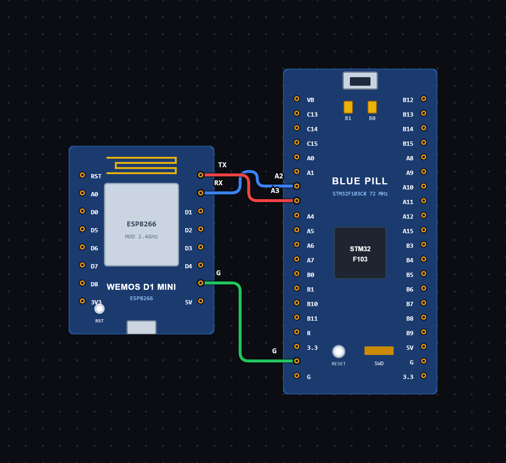
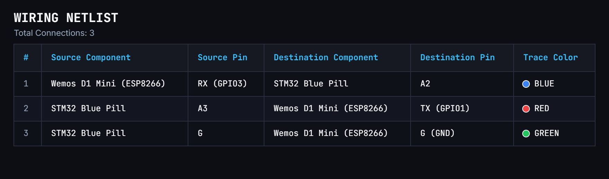
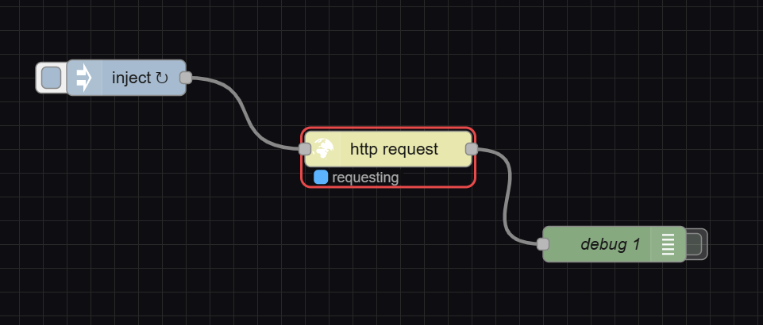

[← Back to STM32 Index](../../README.md) | [← Back to Root Repository](../../../README.md)

# CAT-11 TASK-11B

| Field | Details |
| :--- | :--- |
| **EXP** | Continuous Lab Evaluation-11 (`CAT11` / `TASK11B`) |
| **TASK NO** | **Task 11B — Dynamic HTTP Webpage & Node-RED Integration** |
| **DATE** | 22/10/2026 |
| **NAME OF EXP** | HTTP Server - STM32–Wemos Wi-Fi Modem Using AT Commands |

## HARDWARE SETUP / PLATFORM
- **Development Board:** STM32 Blue Pill (`STM32F103C8T6`) (ARM Cortex-M3, 72 MHz SYSCLK)
- **Toolchain / IDE:** STM32CubeMX + Keil MDK-ARM
- **Firmware Libraries:** STM32F1xx HAL Drivers, CMSIS
- **Peripherals & Software:** Wemos D1 Mini (ESP8266 Wi-Fi Module), Web Browser, and Node-RED Dashboard
- **Pin Mapping:**
  - `PA2` (`USART2_TX`) — Connected to Wemos D1 Mini `RX`
  - `PA3` (`USART2_RX`) — Connected to Wemos D1 Mini `TX`

## Circuit Diagram

### Hardware Schematic

### Wiring Interconnects Table

### Node-RED Flow

## Core Logic / Pseudocode / Code Base

### Working Principle
- `USART2` (`115200` baud, 8-N-1) connects the STM32 Blue Pill to the Wemos D1 Mini (ESP8266) AT interface.
- During startup, the STM32 configures Wi-Fi Station mode (`AT+CWMODE=1`), connects to the Access Point (`AT+CWJAP="<SSID>","<PASSWORD>"`), retrieves its IP (`AT+CIFSR`), and launches a multi-connection TCP server on port `80` (`AT+CIPMUX=1`, `AT+CIPSERVER=1,80`).
- In the `while(1)` loop, incoming UART bytes are buffered into `rx_data` until an HTTP request header (`+IPD,0,` and `GET /`) from a browser or Node-RED HTTP Request node is detected.
- `send_http_response()` generates a random integer (`0–99`), formats an HTML document (`<html><body><h1>Hello!! %d</h1></body></html>`) wrapped in an `HTTP/1.1 200 OK` header, transmits it via `AT+CIPSEND=0,<len>` upon receiving the `>` prompt, and closes the socket (`AT+CIPCLOSE=0`).

### Pseudocode
- Initialize HAL (`HAL_Init`), 72 MHz system clock (`SystemClock_Config`), GPIO (`MX_GPIO_Init`), and `USART2` (`MX_USART2_UART_Init`).
- Transmit `AT`, `AT+CWMODE=1`, `AT+CWJAP`, `AT+CIFSR`, `AT+CIPMUX=1`, and `AT+CIPSERVER=1,80` over `USART2`, waiting for `OK` after each command.
- Seed `srand(HAL_GetTick())` and clear `rx_data`.
- Continuously poll `USART2` in `while(1)`:
  - Append incoming characters into `rx_data`.
  - When both `"+IPD,0,"` and `"GET /"` appear in `rx_data`:
    - Generate a random number (`rand() % 100`) and format the HTML body and `HTTP/1.1 200 OK` response string.
    - Send `AT+CIPSEND=0,<len>` and wait for the `'>'` prompt from the ESP8266.
    - Transmit the HTTP response payload, wait for confirmation, and close link `0` using `AT+CIPCLOSE=0`.
    - Clear `rx_data` to accept the next HTTP request from the browser or Node-RED.

### Code Base
Key functions in `Core/Src/main.c`:
- `HAL_Init()` – Initializes HAL library and SysTick timer.
- `SystemClock_Config()` – Configures 72 MHz system clock (HSE + PLL ×9).
- `MX_GPIO_Init()` – Enables `GPIOA` and `GPIOD` peripheral clocks.
- `MX_USART2_UART_Init()` – Configures `USART2` (115200 baud, 8-N-1) for Wemos D1 Mini communication.
- `clear_buffer()` – Zeroes `rx_data` (`800` bytes) via `memset()` and resets `array_index`.
- `receive_response()` – Reads incoming UART bytes from `huart2` until `"OK"`, `"ERROR"`, `"FAIL"`, or `"<"` is matched.
- `send_http_response()` – Generates a dynamic HTML payload (`rand() % 100`), wraps it with HTTP/1.1 headers via `sprintf()`, transmits it using `AT+CIPSEND=0,<len>`, and closes the connection with `AT+CIPCLOSE=0`.

## INFERENCE
- Implemented an embedded HTTP/1.1 web server on STM32F103C8T6 (`USART2`) and Wemos D1 Mini capable of serving dynamic HTML content on port `80`.
- Verified end-to-end HTTP polling and dynamic data visualization in both a standard web browser and a Node-RED flow.
