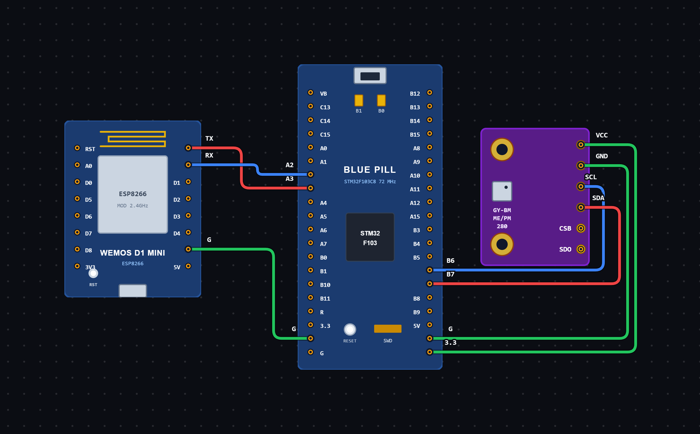
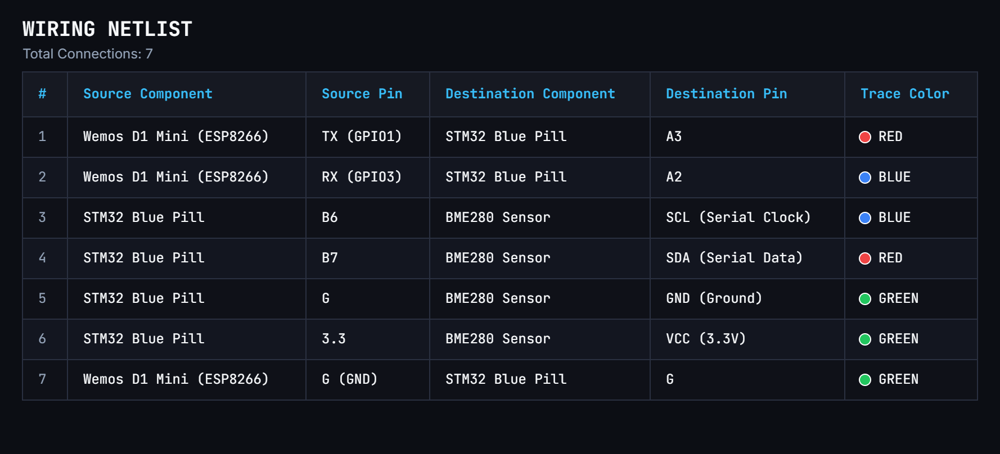

[← Back to STM32 Index](../../README.md) | [← Back to Root Repository](../../../README.md)

# CAT-13 TASK-13

| Field | Details |
| :--- | :--- |
| **EXP** | Continuous Lab Evaluation-13 (`CAT13` / `TASK13`) |
| **TASK NO** | **Task 13 — BME280 Sensor Interfacing & HTTP Web Dashboard** |
| **DATE** | 23/10/2026 |
| **NAME OF EXP** | Sensor Interfacing (BME280) - STM32 (Debug) ESP8266(Wi-Fi) HTTP Node Analytics |

## HARDWARE SETUP / PLATFORM
- **Development Board:** STM32 Blue Pill (`STM32F103C8T6`) (ARM Cortex-M3, 72 MHz SYSCLK)
- **Toolchain / IDE:** STM32CubeMX + Keil MDK-ARM
- **Firmware Libraries:** STM32F1xx HAL Drivers, CMSIS, Bosch BME280 Sensor API (`bme280.h` / `bme280.c`)
- **Peripherals:** Bosch BME280 Environmental Sensor (`I2C1`) and Wemos D1 Mini (ESP8266 Wi-Fi Module, `USART2`)
- **Pin Mapping:**
  - `PB6` (`I2C1_SCL`) — Connected to BME280 `SCL`
  - `PB7` (`I2C1_SDA`) — Connected to BME280 `SDA`
  - `PA2` (`USART2_TX`) — Connected to Wemos D1 Mini `RX`
  - `PA3` (`USART2_RX`) — Connected to Wemos D1 Mini `TX`

## Circuit Diagram

### Hardware Schematic

### Wiring Interconnects Table

## Core Logic / Pseudocode / Code Base

### Working Principle
- `I2C1` (`100 kHz`, 7-bit addressing) interfaces the STM32 with the Bosch BME280 sensor (`0x76` primary address) via custom HAL I2C callbacks (`user_i2c_read`, `user_i2c_write`, `user_delay_us`), configured with 1× oversampling for temperature, pressure, and humidity in `BME280_POWERMODE_NORMAL`.
- `USART2` (`115200` baud) connects to the Wemos D1 Mini (ESP8266), joining the Wi-Fi network (`AT+CWJAP="<SSID>","<PASSWORD>"`), capturing the IP via `AT+CIFSR`, and starting a multi-connection TCP server on port `80` (`AT+CIPMUX=1`, `AT+CIPSERVER=1,80`).
- Inside `while(1)`, `bme280_get_sensor_data()` continuously updates `temperature` (°C), `pressure` (hPa), and `humidity` (%). When an HTTP request (`+IPD,<id>,...\r\n\r\n`) arrives:
  - `GET / ` — Serves an HTML page containing a JavaScript `fetch('/data')` routine polling every `1000 ms`.
  - `GET /data` — Returns live formatted temperature, pressure, and humidity readings (`text/html`) via `AT+CIPSEND`.
  - Any other route — Responds with `"Not Found"`.

### Pseudocode
- Initialize HAL (`HAL_Init`), 72 MHz clock (`SystemClock_Config`), GPIO (`MX_GPIO_Init`), `I2C1` (`MX_I2C1_Init`), and `USART2` (`MX_USART2_UART_Init`).
- Bind Bosch BME280 callbacks (`user_i2c_read`, `user_i2c_write`, `user_delay_us`), call `bme280_init()`, set 1× oversampling, and enable `BME280_POWERMODE_NORMAL`.
- Initialize the ESP8266 over `USART2` using `AT`, `AT+CWMODE=1`, `AT+CWJAP`, `AT+CIFSR` (saving `ip_info`), `AT+CIPMUX=1`, and `AT+CIPSERVER=1,80`.
- Continuously loop in `while(1)`:
  - Read compensated temperature, pressure (`Pa / 100.0f` → `hPa`), and humidity via `bme280_get_sensor_data()`.
  - Buffer incoming `USART2` bytes until `+IPD,` and `\r\n\r\n` are detected; extract `conn_id`.
  - Serve the auto-refreshing dashboard for `GET / `, live BME280 readings for `GET /data`, or `"Not Found"` otherwise, then close `conn_id` (`AT+CIPCLOSE`) and clear `rx_data`.

### Code Base
Key functions in `Core/Src/main.c`:
- `HAL_Init()` / `SystemClock_Config()` – Initializes HAL and configures the 72 MHz system clock.
- `MX_I2C1_Init()` – Configures `I2C1` at 100 kHz for BME280 sensor communication.
- `MX_USART2_UART_Init()` – Configures `USART2` at 115200 baud for ESP8266 AT communication.
- `user_i2c_read()` / `user_i2c_write()` / `user_delay_us()` – Bosch BME280 platform abstraction callbacks wrapping `HAL_I2C_Mem_Read()`, `HAL_I2C_Mem_Write()`, and `HAL_Delay()`.
- `bme280_init()` / `bme280_set_sensor_settings()` / `bme280_set_sensor_mode()` / `bme280_get_sensor_data()` – Bosch BME280 driver functions for calibration, configuration, and compensated readout.
- `clear_buffer()` / `receive_response()` – Manages `rx_data` buffer and checks for `"OK\r\n"`, `"ERROR"`, or `"FAIL"`.
- `send_http_response()` – Formats HTTP/1.1 headers and payload via `snprintf()` and transmits them over `AT+CIPSEND` followed by `AT+CIPCLOSE`.

## INFERENCE
- Successfully interfaced the Bosch BME280 environmental sensor over `I2C1` (`PB6`/`PB7`) with the STM32F103C8T6 using the official Bosch sensor API.
- Built a live HTTP IoT telemetry server over `USART2` + Wemos D1 Mini that serves real-time temperature, pressure, and humidity updates every second via asynchronous JavaScript `fetch('/data')` requests.
