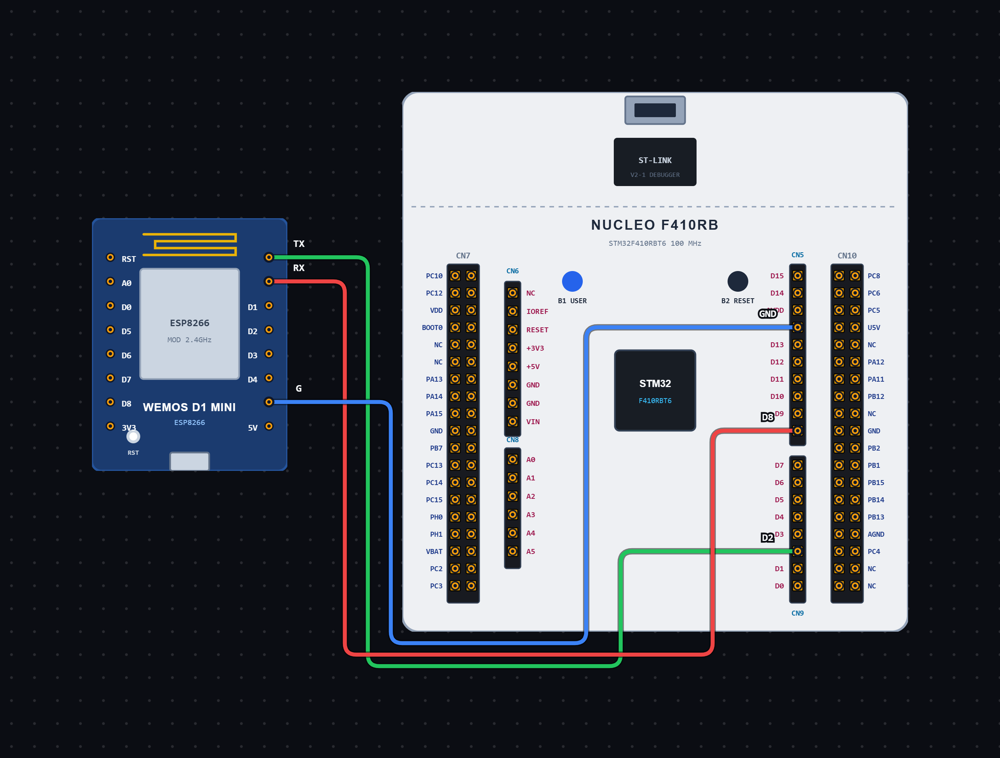
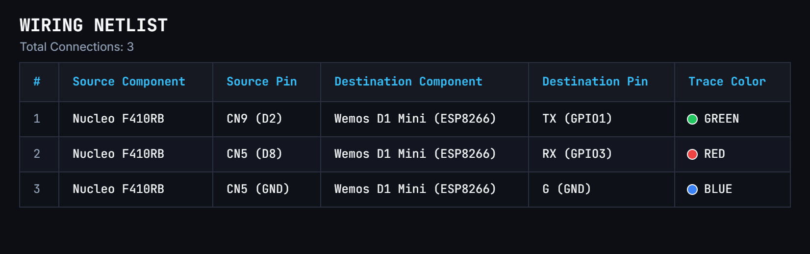
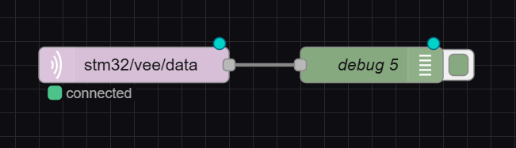

[← Back to STM32 Index](../../README.md) | [← Back to Root Repository](../../../README.md)

# CAT-14 TASK-14

| Field | Details |
| :--- | :--- |
| **EXP** | Continuous Lab Evaluation-14 (`CAT14` / `TASK14`) |
| **TASK NO** | **Task 14 — MQTT Client Publishing & Node-RED Integration** |
| **DATE** | 29/10/2026 |
| **NAME OF EXP** | Sensor Interfacing (BME280) – (MQTT) – Node Analytics |

## HARDWARE SETUP / PLATFORM
- **Development Board:** STMicroelectronics NUCLEO-F410RB (`STM32F410RBT6`) (ARM Cortex-M4, 84 MHz SYSCLK)
- **Toolchain / IDE:** STM32CubeMX + Keil MDK-ARM
- **Firmware Libraries:** STM32F4xx HAL Drivers, CMSIS, Custom ESP8266/MQTT Library (`ESPLib.h`,`ESPLib.c`)
- **Peripherals & Services:** Wemos D1 Mini (ESP8266 Wi-Fi Module, `USART1`), Public EMQX MQTT Broker (`broker.emqx.io:1883`), and Node-RED Subscriber Flow
- **Pin Mapping:**
  - `PA9` (`USART1_TX`) — Connected to Wemos D1 Mini `RX`
  - `PA10` (`USART1_RX`) — Connected to Wemos D1 Mini `TX`

## Circuit Diagram

### Hardware Schematic

### Wiring Interconnects Table

### Node-RED Flow

## Core Logic / Pseudocode / Code Base

### Working Principle
- `USART1` (`115200` baud, 8-N-1) connects the STM32 NUCLEO-F410RB to the Wemos D1 Mini (ESP8266) driven by the `ESPLib` AT/MQTT driver stack.
- During startup, `ESP8266_Init()` sets the module to `StationMode`, `ESP8266_wifiConnect("<SSID>", "<PASSWORD>")` associates with the local Wi-Fi network, and `ESP8266_portConnect("TCP", "broker.emqx.io", "1883")` opens a TCP socket to the EMQX MQTT broker on port `1883`.
- An `MQTT_InitTypeDef_t` session (`clientID = "STM32_Publisher"`, `keepAlive = 500`, `CleanSession`) is established via `MQTT_connectBroker()`.
- Inside the continuous `while(1)` loop, `MQTT_publishTopic("stm32/vee/data", "Hello From STM32", QoS0)` publishes a QoS 0 MQTT payload every `1000 ms`, which is subscribed to and visualized in real time by a Node-RED MQTT-in flow.

### Pseudocode
- Initialize HAL (`HAL_Init`), 84 MHz system clock (`SystemClock_Config`), GPIO (`MX_GPIO_Init`), and `USART1` (`MX_USART1_UART_Init`).
- Initialize ESP8266 in Station mode (`ESP8266_Init(StationMode, huart1)`) and connect to Wi-Fi (`ESP8266_wifiConnect`).
- Open a TCP connection to `"broker.emqx.io"` on port `"1883"` using `ESP8266_portConnect()`.
- Configure `MQTT_InitTypeDef_t` (`keepAlive = 500`, `CleanSession`, `clientID = "STM32_Publisher"`) and send the MQTT CONNECT packet via `MQTT_connectBroker()`.
- Continuously loop in `while(1)`:
  - Publish `"Hello From STM32"` to topic `"stm32/vee/data"` with `QoS0` via `MQTT_publishTopic()`.
  - Delay `1000 ms` using `HAL_Delay(1000)`.
- Subscribe to `"stm32/vee/data"` on `broker.emqx.io:1883` in Node-RED to receive and display incoming messages.

### Code Base
Key functions in `Core/Src/main.c`:
- `HAL_Init()` – Initializes HAL library and 1 ms SysTick timer.
- `SystemClock_Config()` – Configures HSI with PLL (`PLLM = 8`, `PLLN = 84`, `PLLP = 2`) to generate an 84 MHz system clock.
- `MX_USART1_UART_Init()` – Configures `USART1` (`PA9`/`PA10`) at 115200 baud for ESP8266 communication.
- `ESP8266_Init()` – Initializes the ESP8266 module in Wi-Fi Station mode on `huart1`.
- `ESP8266_wifiConnect()` – Connects the ESP8266 to the configured Wi-Fi Access Point.
- `ESP8266_portConnect()` – Establishes a TCP socket connection to `broker.emqx.io` on port `1883`.
- `MQTT_connectBroker()` – Performs the MQTT handshake using `MQTT_InitTypeDef_t` (`CleanSession`, `keepAlive = 500`).
- `MQTT_publishTopic()` – Encapsulates and transmits MQTT PUBLISH packets to `"stm32/vee/data"` at `QoS0`.

## INFERENCE
- Implemented an MQTT publisher client on the STM32F410RB (`NUCLEO-F410RB`) using `USART1` and the `ESPLib` AT/MQTT driver stack over an ESP8266 Wi-Fi link.
- Verified TCP socket establishment (`port 1883`), MQTT broker handshake (`broker.emqx.io`), and periodic QoS 0 message publishing (`stm32/vee/data`) received live in the Node-RED subscriber flow.
