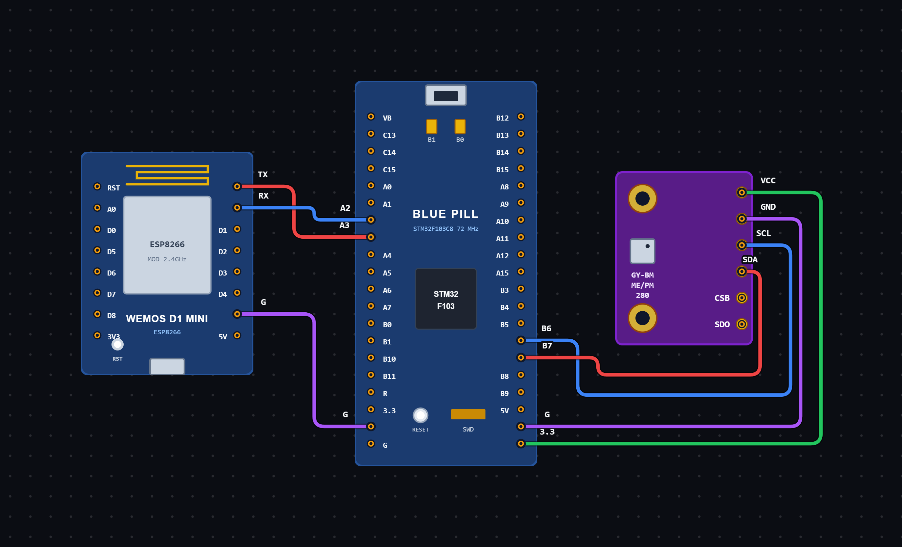
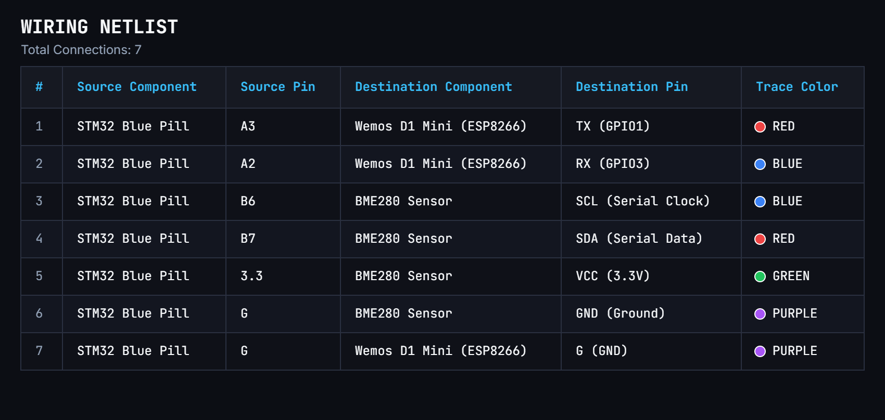
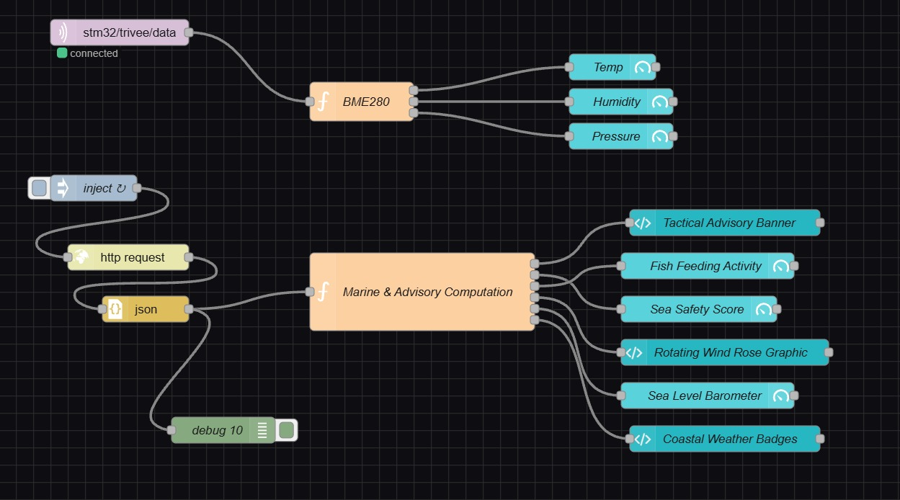
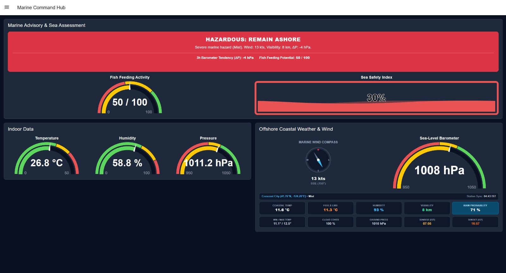
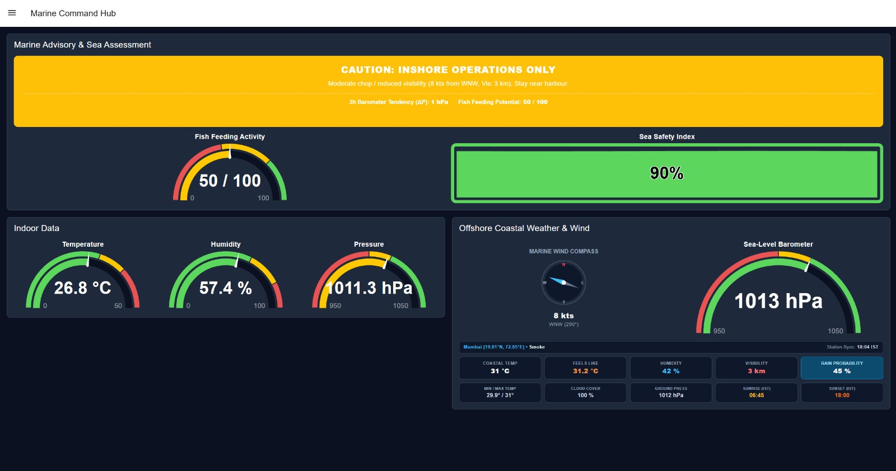
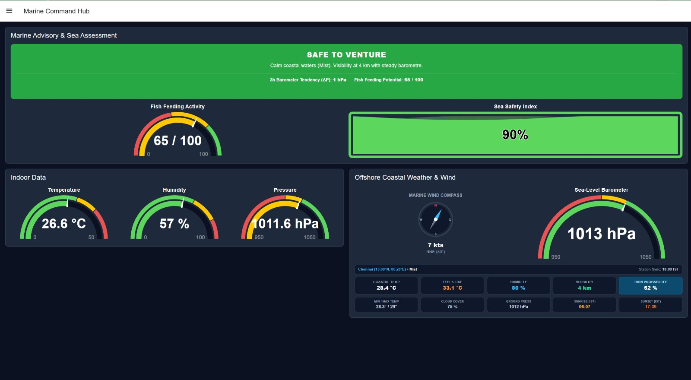

[← Back to STM32 Index](../README.md) | [← Back to Root Repository](../../README.md)

# Smart Fisherman Advisory System with Real-Time Weather Telemetry

> **Course Project:** Fundamentals of Internet of Things (`CAT-15` Mini Project)  
> **Platform:** STM32F103C8T6 (`Blue Pill`, ARM Cortex-M3 @ 72 MHz)  
> **Architecture:** Edge MQTT Telemetry + OpenWeather API + Node-RED Decision Engine

---

## Project Overview
**Smart Fisherman Advisory System with Real-Time Weather Telemetry** is an end-to-end IoT marine decision-support system designed to assist small-craft fishermen before venturing out to sea. It fuses real-time local environmental telemetry from an **STM32 + BME280** edge node (streamed via **MQTT**) with live offshore coastal forecasts from the **OpenWeather API** inside **Node-RED**, automatically generating sea-safety advisories, catch-activity scores, and live telemetry gauges.

---

## Hardware & Software Stack
- **Microcontroller:** STMicroelectronics `STM32F103C8T6` (`Blue Pill`, ARM Cortex-M3 @ 72 MHz)
- **Environmental Sensor:** Bosch `BME280` (`I2C1` — `PB6` SCL, `PB7` SDA, address `0x76`)
- **Wi-Fi Telemetry Module:** `Wemos D1 Mini` / `ESP8266` (`USART2` — `PA2` TX, `PA3` RX @ 115200 baud)
- **Messaging & Cloud APIs:** EMQX MQTT Broker (`broker.emqx.io:1883`, topic `stm32/trivee/data`) & OpenWeather REST API
- **Analytics & Dashboard:** Node-RED (`node-red-dashboard`)

---

## System Architecture & Visuals

### Hardware Schematic

### Wiring Interconnects

### Node-RED Data & Advisory Flow

### Telemetry & Advisory Dashboard

---

## Working Principle

### 1. Dual-Source Data Acquisition
- **Local Edge Telemetry (BME280 → STM32 → MQTT):**
  - The STM32 reads compensated **Temperature (°C)**, **Humidity (%)**, and **Barometric Pressure (hPa)** from the BME280 over `I2C1`, formats the readings into JSON (`{"temperature":...,"pressure":...,"humidity":...}`), and publishes them over `USART2` via the ESP8266 to the MQTT topic `stm32/trivee/data`.
- **Offshore Marine Forecast (OpenWeather API → HTTP Request):**
  - Node-RED periodically queries the **OpenWeather API** via an HTTP Request node and parses the JSON response to obtain live offshore coastal conditions.

### 2. Fishermen Safety Advisories & Decision Engine
Node-RED's **Marine & Advisory Computation** engine evaluates offshore wind speed, visibility, rain probability, and 3-hour barometric pressure tendency (`ΔP`) to classify sea conditions into three actionable advisory tiers:
- **SAFE TO VENTURE:** Calm winds, high visibility, and steady barometric pressure—favorable for open-water fishing.
- **CAUTION: INSHORE OPERATIONS ONLY:** Moderate wind gusts, reduced visibility, or minor pressure fluctuations—advises fishermen to stay near coastal waters.
- **HAZARDOUS: REMAIN ASHORE:** Severe marine hazards such as mist/low visibility, strong winds, high rain probability, or rapid barometric pressure drops (`ΔP`)—warns boats to remain docked.

### 3. Dashboard Telemetry & Indicators
- **Decision Indices:**
  - **Sea Safety Index (`0–100%`):** Overall navigation safety score derived from wind, visibility, and pressure stability.
  - **Fish Feeding Activity (`0–100`):** Fishing potential score calculated from barometric pressure trends, cloud cover, and coastal weather conditions.
- **Indoor Data (Live BME280 Node):**
  - **Temperature (`°C`)**, **Humidity (`%`)**, and **Pressure (`hPa`)** gauges.
- **Offshore Coastal Weather & Wind Telemetry (OpenWeather API):**
  - **Marine Wind Compass:** Live wind speed (`kts`) and directional heading (`SSE 156°`).
  - **Sea-Level Barometer (`hPa`):** Live atmospheric pressure gauge with 3-hour tendency (`ΔP`).
  - **Coastal Weather Badges:** Coastal Temperature (`°C`), Feels-Like Temp, Coastal Humidity (`%`), Visibility (`km`), Rain Probability (`%`), Min/Max Temp, Cloud Cover (`%`), Ground Pressure (`hPa`), Sunrise (`IST`), and Sunset (`IST`).

---

## Firmware Highlights (`Core/Src/main.c`)
- `MX_I2C1_Init()` & `MX_USART2_UART_Init()` — Configures `I2C1` (100 kHz) for the BME280 sensor and `USART2` (115200 baud) for ESP8266 AT communication.
- `bme280_init()` & `bme280_get_sensor_data()` — Initializes the Bosch BME280 driver (`0x76`, `BME280_POWERMODE_NORMAL`) and reads calibrated environmental metrics.
- `ESP8266_Init()` / `ESP8266_wifiConnect()` / `ESP8266_portConnect()` — Connects the ESP8266 to Wi-Fi and opens a TCP socket to `broker.emqx.io:1883`.
- `MQTT_connectBroker()` & `MQTT_publishTopic()` — Connects as `STM32_publisher` and streams JSON sensor payloads to `stm32/trivee/data`.

---

## Conclusion & Outcome
- Successfully integrated edge sensor telemetry (`STM32 + BME280 + MQTT`) with cloud meteorological data (`OpenWeather API`) inside a unified **Smart Fisherman Advisory System with Real-Time Weather Telemetry** dashboard.
- Demonstrated how raw environmental and coastal weather variables can be transformed into real-time, easy-to-interpret safety warnings (`SAFE TO VENTURE`, `CAUTION: INSHORE OPERATIONS ONLY`, `HAZARDOUS: REMAIN ASHORE`) and catch-activity insights for fishermen.
