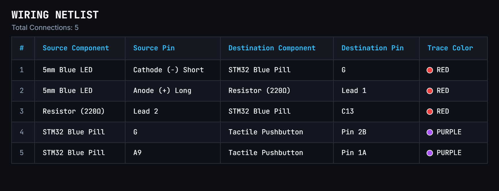

[← Back to STM32 Index](../../README.md) | [← Back to Root Repository](../../../README.md)

## EXP
Continuous Lab Evaluation-8 (`CAT8` / `TASK8A`)

## TASK NO
**Task 8A — GPIO Input/Output**

## DATE
24/09/2026

## NAME OF EXP
STM32 GPIO Bring-Up and Switch-Controlled LED

## HARDWARE SETUP / PLATFORM
- **Development Board:** STM32 Blue Pill (`STM32F103C8T6`) (ARM Cortex-M3, 72 MHz SYSCLK)
- **Toolchain / IDE:** STM32CubeMX + Keil MDK-ARM
- **Firmware Libraries:** STM32F1xx HAL Drivers, CMSIS
- **Peripherals:** Push-button switch and onboard LED
- **Pin Mapping:**
  - `PA9` — Push-button input
  - `PC13` — Onboard LED output 

## Circuit Diagram

### Hardware Schematic

### Wiring Interconnects Table

## Core Logic / Pseudocode / Code Base

### Working Principle
- `PA9` is configured as an input with an internal pull-up (`GPIO_PULLUP`), reading `HIGH` when idle and `LOW` when pressed.
- `PC13` is configured as a push-pull output (`GPIO_MODE_OUTPUT_PP`) driving the active-low onboard LED.
- In the `while(1)` loop, `HAL_GPIO_ReadPin()` polls `PA9` and `HAL_GPIO_WritePin()` mirrors its state to `PC13`:
  - `PA9 == LOW` (pressed) → `PC13 = LOW` (LED ON)
  - `PA9 == HIGH` (released) → `PC13 = HIGH` (LED OFF)

### Pseudocode
- Initialize HAL (`HAL_Init`), 72 MHz clock (`SystemClock_Config`), and GPIO (`MX_GPIO_Init`).
- Configure `PA9` as pull-up input and `PC13` as push-pull output.
- Continuously poll `PA9` in `while(1)`:
  - If `PA9` is `LOW`, set `PC13` `LOW` (LED ON).
  - Else, set `PC13` `HIGH` (LED OFF).

### Code Base
Key functions in `Core/Src/main.c`:
- `HAL_Init()` – Initializes HAL library and SysTick timer.
- `SystemClock_Config()` – Configures 72 MHz system clock (HSE + PLL ×9).
- `MX_GPIO_Init()` – Configures `PA9` (input pull-up) and `PC13` (output push-pull).
- `HAL_GPIO_ReadPin()` – Reads logic state of `PA9`.
- `HAL_GPIO_WritePin()` – Drives `PC13` LOW or HIGH based on switch state.

## INFERENCE
- Configured digital GPIO input and output on STM32F103C8T6 using STM32 HAL drivers.
- Verified real-time switch polling where the active-low `PC13` LED follows the push-button state on `PA9`.
