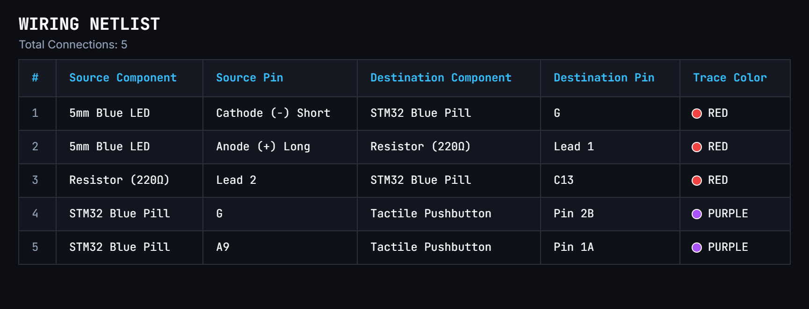

[← Back to STM32 Index](../../README.md) | [← Back to Root Repository](../../../README.md)

# CAT-8 TASK-8B

| Field | Details |
| :--- | :--- |
| **EXP** | Continuous Lab Evaluation-8 (`CAT8` / `TASK8B`) |
| **TASK NO** | **Task 8B — Event-Based Control** |
| **DATE** | 24/09/2026  |
| **NAME OF EXP** | STM32 GPIO Bring-Up and Switch-Controlled LED |

## HARDWARE SETUP / PLATFORM
- **Development Board:** STM32 Blue Pill (`STM32F103C8T6`) (ARM Cortex-M3, 72 MHz SYSCLK)
- **Toolchain / IDE:** STM32CubeMX + Keil MDK-ARM
- **Firmware Libraries:** STM32F1xx HAL Drivers, CMSIS
- **Peripherals:** Push-button switch and onboard LED
- **Pin Mapping:**
  - `PA9` — Push-button input
  - `PC13` — Onboard LED output

## Circuit Diagram

### Hardware Schematic

### Wiring Interconnects Table

## Core Logic / Pseudocode / Code Base

### Working Principle
- `PA9` is configured as a digital input (`GPIO_MODE_INPUT`), while `PC13` is configured as a push-pull output (`GPIO_MODE_OUTPUT_PP`) driving the onboard LED.
- When `PA9` reads `HIGH` (`GPIO_PIN_SET`), the firmware waits `10 ms` using `HAL_Delay(10)` to filter out mechanical switch bounce.
- If `PA9` still reads `HIGH` after the debounce window, `HAL_GPIO_TogglePin()` toggles the `PC13` LED state.
- A blocking `while` loop waits until `PA9` returns `LOW` (button released), ensuring one physical press triggers exactly one LED toggle.

### Pseudocode
- Initialize HAL (`HAL_Init`), 72 MHz clock (`SystemClock_Config`), and GPIO (`MX_GPIO_Init`).
- Configure `PA9` as digital input and `PC13` as push-pull output.
- Loop continuously in `while(1)`:
  - Check if `PA9` reads `HIGH` (`GPIO_PIN_SET`).
  - Wait `10 ms` (`HAL_Delay(10)`) for switch debouncing and re-verify `PA9 == HIGH`.
  - Toggle `PC13` state using `HAL_GPIO_TogglePin()`.
  - Wait in a `while` loop until `PA9` is released (`LOW`) before accepting the next press.

### Code Base
Key functions in `Core/Src/main.c`:
- `HAL_Init()` – Initializes HAL library and SysTick timer.
- `SystemClock_Config()` – Configures 72 MHz system clock (HSE + PLL ×9).
- `MX_GPIO_Init()` – Configures `PA9` (input) and `PC13` (output push-pull).
- `HAL_GPIO_ReadPin()` – Reads logic state of `PA9` for press and release detection.
- `HAL_Delay()` – Provides a 10 ms software debounce delay.
- `HAL_GPIO_TogglePin()` – Toggles `PC13` LED state once per valid button press.

## INFERENCE
- Implemented event-based switch toggle control with 10 ms software debouncing on STM32F103C8T6 using STM32 HAL drivers.
- Verified that mechanical switch bounce is eliminated and holding the button down produces only a single state toggle on `PC13`.
