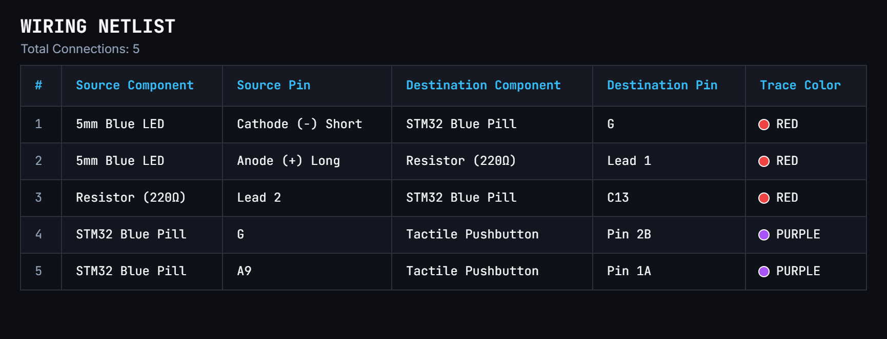

[← Back to STM32 Index](../../README.md) | [← Back to Root Repository](../../../README.md)

# CAT-8 TASK-8C

| Field | Details |
| :--- | :--- |
| **EXP** | Continuous Lab Evaluation-8 (`CAT8` / `TASK8C`) |
| **TASK NO** | **Task 8C — Short Press vs Long Press** |
| **DATE** | 24/09/2026  |
| **NAME OF EXP** | STM32 GPIO Bring-Up and Switch-Controlled LED |

## HARDWARE SETUP / PLATFORM
- **Development Board:** STM32 Blue Pill (`STM32F103C8T6`) (ARM Cortex-M3, 72 MHz SYSCLK)
- **Toolchain / IDE:** STM32CubeMX + Keil MDK-ARM
- **Firmware Libraries:** STM32F1xx HAL Drivers, CMSIS
- **Peripherals:** Push-button switch and onboard LED
- **Pin Mapping:**
  - `PA9` — Push-button input
  - `PC13` — Onboard LED output

## Circuit Diagram

### Hardware Schematic

### Wiring Interconnects Table

## Core Logic / Pseudocode / Code Base

### Working Principle
- `PA9` is configured as a digital input with an internal pull-up (`GPIO_PULLUP`, active-low), and `PC13` is configured as a push-pull output (`GPIO_MODE_OUTPUT_PP`) driving the active-low onboard LED.
- Instead of blocking delays, the firmware uses `HAL_GetTick()` to measure the elapsed millisecond duration between button press (`PA9 == LOW`) and release (`PA9 == HIGH`):
  - **Short Press (`duration < 1000 ms`):**
    - If `blinking == 1`, exits blinking mode (`blinking = 0`) and turns the LED OFF (`PC13 = HIGH`).
    - Otherwise, toggles the current LED state via `HAL_GPIO_TogglePin()`.
  - **Long Press (`duration >= 1000 ms`):** Enables continuous blinking mode (`blinking = 1`) and initializes `blink_timer`.
- When `blinking == 1`, `HAL_GetTick()` toggles `PC13` every `500 ms` in a non-blocking manner.

### Pseudocode
- Initialize HAL (`HAL_Init`), 72 MHz clock (`SystemClock_Config`), and GPIO (`MX_GPIO_Init`).
- Maintain state flags (`is_pressed`, `blinking`) and millisecond timestamps (`press_time`, `blink_timer`).
- Continuously execute in `while(1)`:
  - Read `PA9` state (`LOW` = pressed).
  - On falling edge (button pressed), set `is_pressed = 1` and record `press_time = HAL_GetTick()`.
  - On rising edge (button released), clear `is_pressed = 0` and compute `duration = HAL_GetTick() - press_time`:
    - If `duration < 1000 ms`:
      - If `blinking == 1`, set `blinking = 0` and drive `PC13` `HIGH` (LED OFF).
      - Else, toggle `PC13`.
    - Else (`duration >= 1000 ms`):
      - Set `blinking = 1` and record `blink_timer = HAL_GetTick()`.
  - If `blinking == 1` and `HAL_GetTick() - blink_timer >= 500 ms`, toggle `PC13` and update `blink_timer`.

### Code Base
Key functions in `Core/Src/main.c`:
- `HAL_Init()` – Initializes HAL library and 1 ms SysTick timer.
- `SystemClock_Config()` – Configures 72 MHz system clock (HSE + PLL ×9).
- `MX_GPIO_Init()` – Configures `PA9` (input pull-up) and `PC13` (output push-pull).
- `HAL_GPIO_ReadPin()` – Detects button press and release transitions on `PA9`.
- `HAL_GetTick()` – Provides non-blocking millisecond timestamps for press duration and 500 ms blink timing.
- `HAL_GPIO_WritePin()` – Turns off `PC13` (`GPIO_PIN_SET`) when exiting blinking mode.
- `HAL_GPIO_TogglePin()` – Toggles `PC13` on short press and during 500 ms blinking intervals.

## INFERENCE
- Implemented non-blocking short-press (`< 1 s`) and long-press (`≥ 1 s`) classification on STM32F103C8T6 using `HAL_GetTick()` timestamps.
- Verified that a long press initiates a continuous 500 ms non-blocking LED blink mode on `PC13`, while a subsequent short press cleanly stops blinking and turns the LED OFF.
