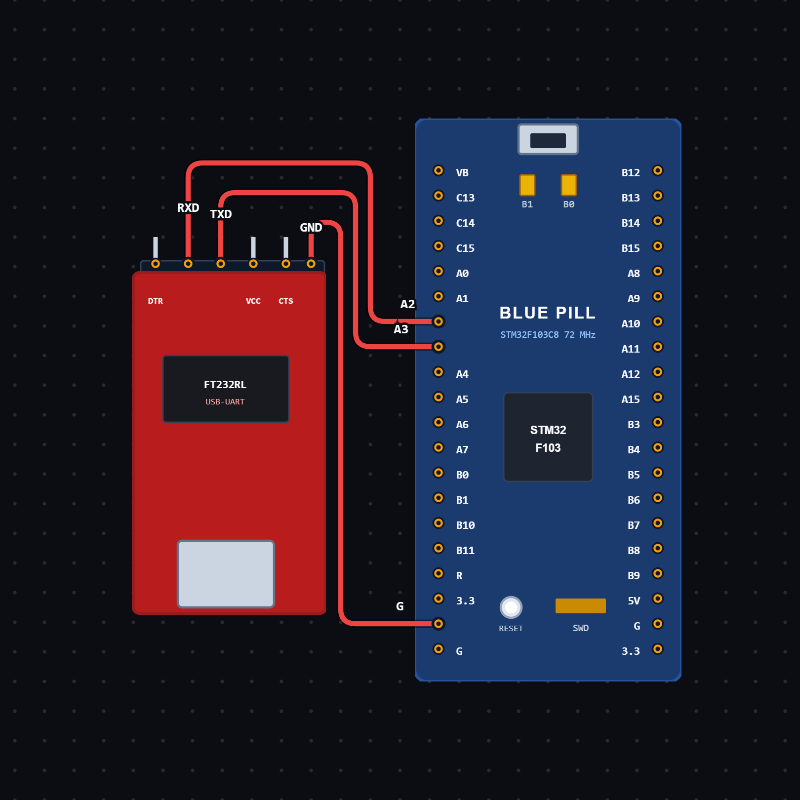
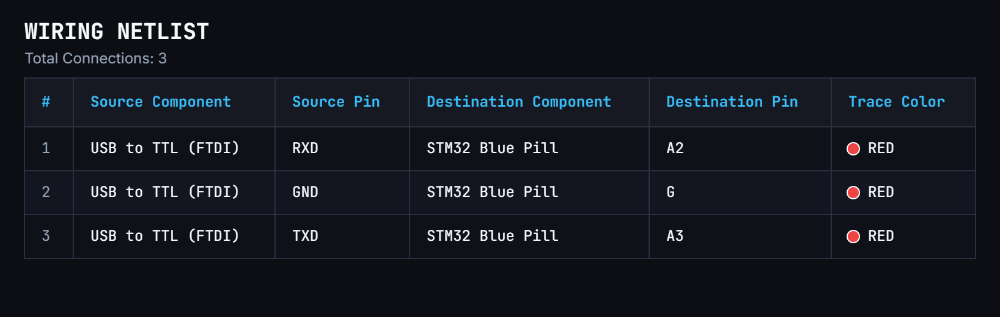

[← Back to STM32 Index](../../README.md) | [← Back to Root Repository](../../../README.md)

# CAT-9 TASK-9A

| Field | Details |
| :--- | :--- |
| **EXP** | Continuous Lab Evaluation-9 (`CAT9` / `TASK9A`) |
| **TASK NO** | **Task 9A — Basic UART Communication** |
| **DATE** | 01/10/2026 |
| **NAME OF EXP** | STM32 UART Command Controlled LED |

## HARDWARE SETUP / PLATFORM
- **Development Board:** STM32 Blue Pill (`STM32F103C8T6`) (ARM Cortex-M3, 72 MHz SYSCLK)
- **Toolchain / IDE:** STM32CubeMX + Keil MDK-ARM
- **Firmware Libraries:** STM32F1xx HAL Drivers, CMSIS
- **Peripherals:** USB-to-TTL Serial Converter (`USART2`) and PC Serial Terminal (PuTTY)
- **Pin Mapping:**
  - `PA2` — `USART2_TX` (connected to USB-to-TTL `RX`)
  - `PA3` — `USART2_RX` (connected to USB-to-TTL `TX`)
  - `GND` — Common ground reference

## Circuit Diagram

### Hardware Schematic

### Wiring Interconnects Table

## Core Logic / Pseudocode / Code Base

### Working Principle
- `USART2` is configured in asynchronous full-duplex TX/RX mode (`115200` baud, 8 data bits, 1 stop bit, no parity) to communicate with a PC serial terminal.
- Inside the `while(1)` loop, `HAL_UART_Receive()` blocks until a single byte (`rx_char`) arrives over `PA3` (`USART2_RX`).
- Once received (`HAL_OK`), `HAL_UART_Transmit()` immediately echoes the same character back over `PA2` (`USART2_TX`) to the PC terminal.

### Pseudocode
- Initialize HAL (`HAL_Init`), 72 MHz system clock (`SystemClock_Config`), GPIO (`MX_GPIO_Init`), and `USART2` (`MX_USART2_UART_Init`) at 115200-8-N-1.
- Loop continuously in `while(1)`:
  - Wait to receive 1 byte (`rx_char`) from `USART2` via `HAL_UART_Receive()`.
  - If reception succeeds (`HAL_OK`), transmit `rx_char` back to the PC terminal via `HAL_UART_Transmit()`.

### Code Base
Key functions in `Core/Src/main.c`:
- `HAL_Init()` – Initializes HAL library and SysTick timer.
- `SystemClock_Config()` – Configures 72 MHz system clock (HSE + PLL ×9).
- `MX_GPIO_Init()` – Enables `GPIOA` and `GPIOD` peripheral clocks.
- `MX_USART2_UART_Init()` – Configures `USART2` for 115200 baud, 8-N-1, TX/RX mode.
- `HAL_UART_Receive()` – Reads one incoming byte from `USART2` in blocking mode.
- `HAL_UART_Transmit()` – Echoes the received character back through `USART2`.

## INFERENCE
- Configured `USART2` (`PA2`/`PA3`) on the STM32F103C8T6 Blue Pill for 115200-8-N-1 serial communication using STM32CubeMX and HAL UART APIs.
- Verified bidirectional character transmission and echo functionality between the STM32 and a PC terminal.
