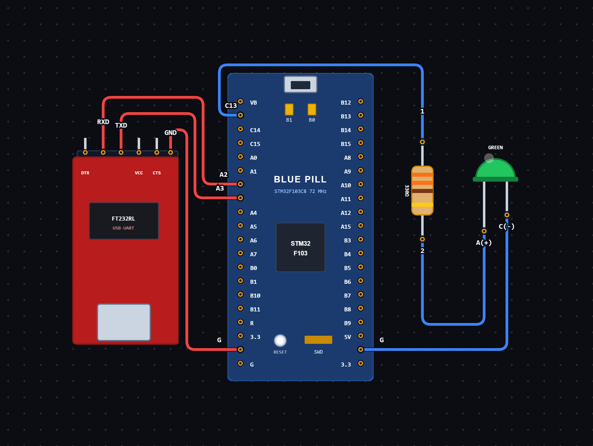
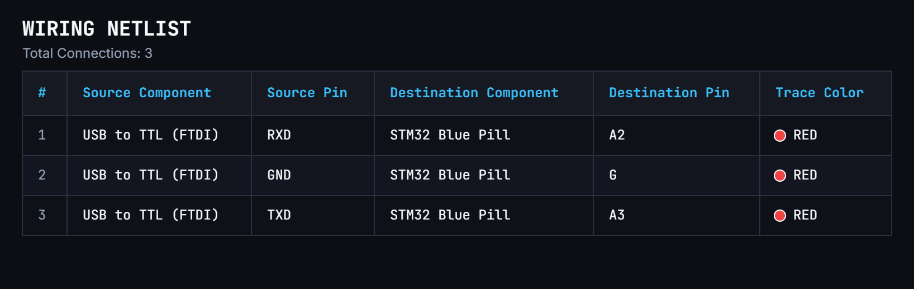

[← Back to STM32 Index](../../README.md) | [← Back to Root Repository](../../../README.md)

# CAT-9 TASK-9B

| Field | Details |
| :--- | :--- |
| **EXP** | Continuous Lab Evaluation-9 (`CAT9` / `TASK9B`) |
| **TASK NO** | **Task 9B — String-Based Application Logic** |
| **DATE** | 01/10/2026 |
| **NAME OF EXP** | STM32 UART Command Controlled LED |

## HARDWARE SETUP / PLATFORM
- **Development Board:** STM32 Blue Pill (`STM32F103C8T6`) (ARM Cortex-M3, 72 MHz SYSCLK)
- **Toolchain / IDE:** STM32CubeMX + Keil MDK-ARM
- **Firmware Libraries:** STM32F1xx HAL Drivers, CMSIS
- **Peripherals:** USB-to-TTL Serial Converter (`USART2`), PC Serial Terminal (PuTTY), and onboard LED
- **Pin Mapping:**
  - `PA2` — `USART2_TX` (connected to USB-to-TTL `RX`)
  - `PA3` — `USART2_RX` (connected to USB-to-TTL `TX`)
  - `PC13` — Onboard LED output

## Circuit Diagram

### Hardware Schematic

### Wiring Interconnects Table

## Core Logic / Pseudocode / Code Base

### Working Principle
- `USART2` operates in asynchronous TX/RX mode (`115200` baud, 8-N-1) while `PC13` is configured as a push-pull output (`GPIO_MODE_OUTPUT_PP`) for the active-low onboard LED.
- Incoming characters from the PC terminal are received one byte at a time via `HAL_UART_Receive()`, echoed back via `HAL_UART_Transmit()`, and accumulated into `command_array` (up to `CMD_MAX_LEN - 1` characters).
- When a carriage return (`'\r'`) or newline (`'\n'`) is received, the string is null-terminated (`'\0'`) and matched using `strcmp()`:
  - `"LED ON"` → Drives `PC13` LOW (`GPIO_PIN_RESET`) and replies `"LED turned ON"`.
  - `"LED OFF"` → Drives `PC13` HIGH (`GPIO_PIN_SET`) and replies `"LED turned OFF"`.
  - `"LED TOGGLE"` → Toggles `PC13` via `HAL_GPIO_TogglePin()` and replies `"LED toggled"`.
- After command execution (or buffer overflow), `array_index` resets to `0` for the next command.

### Pseudocode
- Initialize HAL (`HAL_Init`), 72 MHz clock (`SystemClock_Config`), GPIO (`MX_GPIO_Init`), and `USART2` (`MX_USART2_UART_Init`).
- Declare `command_array[15]` and initialize `array_index = 0`.
- Continuously loop in `while(1)`:
  - Receive 1 byte (`incoming_char`) from `USART2` via `HAL_UART_Receive()` and echo it back via `HAL_UART_Transmit()`.
  - If `incoming_char` is `'\r'` or `'\n'` and `array_index > 0`:
    - Null-terminate `command_array[array_index] = '\0'`.
    - Compare string using `strcmp()` and execute `"LED ON"` (`PC13 = LOW`), `"LED OFF"` (`PC13 = HIGH`), or `"LED TOGGLE"` (`HAL_GPIO_TogglePin()`).
    - Transmit confirmation message over `USART2` and reset `array_index = 0`.
  - Else, append `incoming_char` to `command_array` if `array_index < 14`; otherwise reset `array_index = 0`.

### Code Base
Key functions in `Core/Src/main.c`:
- `HAL_Init()` – Initializes HAL library and SysTick timer.
- `SystemClock_Config()` – Configures 72 MHz system clock (HSE + PLL ×9).
- `MX_GPIO_Init()` – Configures `PC13` as push-pull digital output.
- `MX_USART2_UART_Init()` – Configures `USART2` for 115200 baud, 8-N-1, TX/RX mode.
- `HAL_UART_Receive()` – Reads incoming command characters from `USART2`.
- `HAL_UART_Transmit()` – Echoes typed characters and sends confirmation messages to the terminal.
- `HAL_GPIO_WritePin()` – Sets `PC13` LOW (`LED ON`) or HIGH (`LED OFF`).
- `HAL_GPIO_TogglePin()` – Toggles `PC13` state on `"LED TOGGLE"`.
- `strcmp()` – Matches the null-terminated command string against supported LED commands.

## INFERENCE
- Implemented a string-based UART command interpreter on STM32F103C8T6 (`USART2`) to control the onboard `PC13` LED from a PC serial terminal.
- Verified accurate character accumulation, delimiter-based string termination (`\r`/`\n`), command matching (`LED ON`, `LED OFF`, `LED TOGGLE`), and serial feedback responses.
